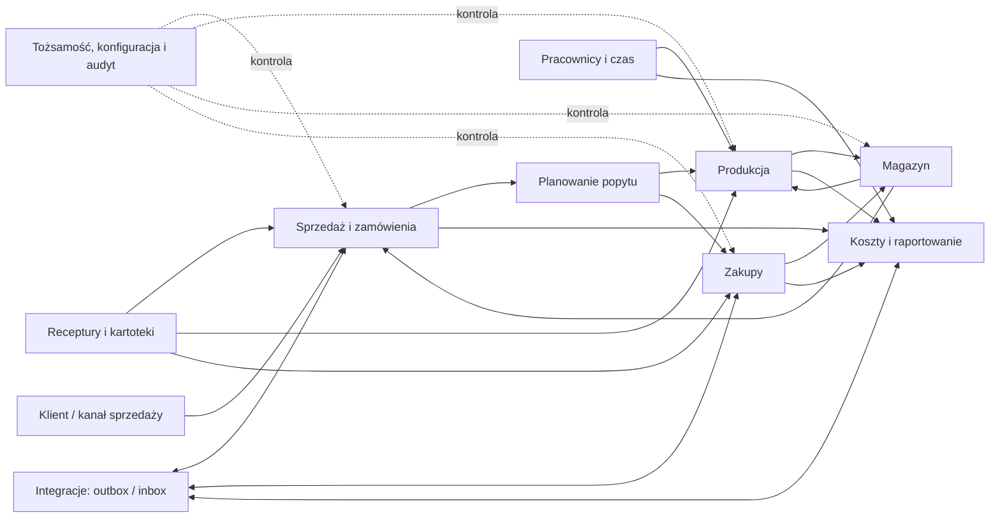
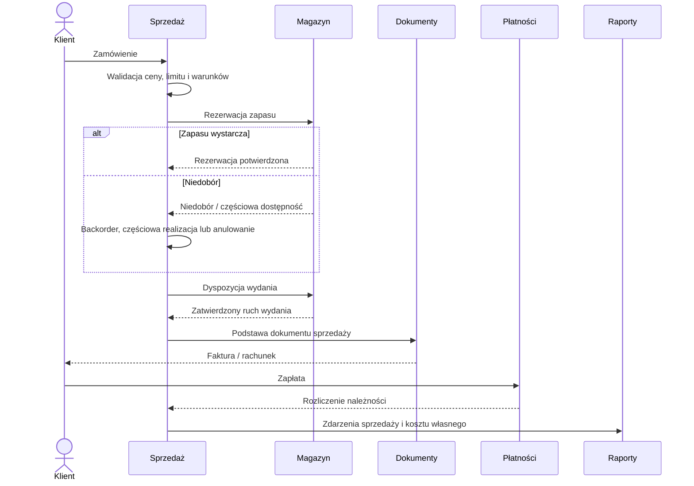
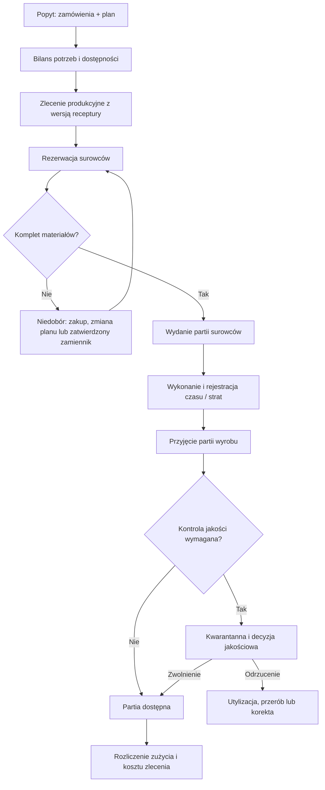
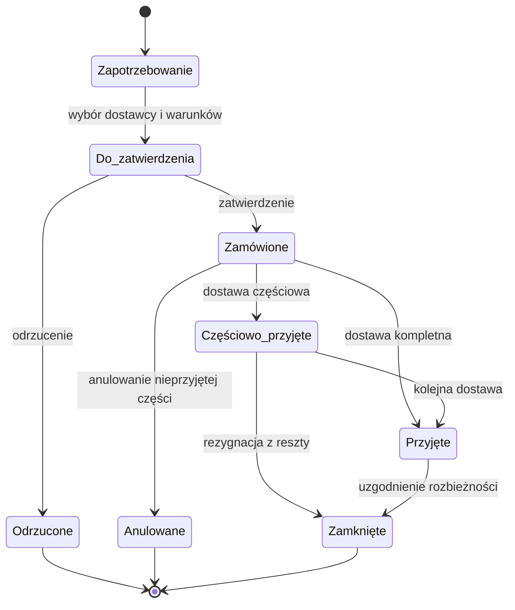
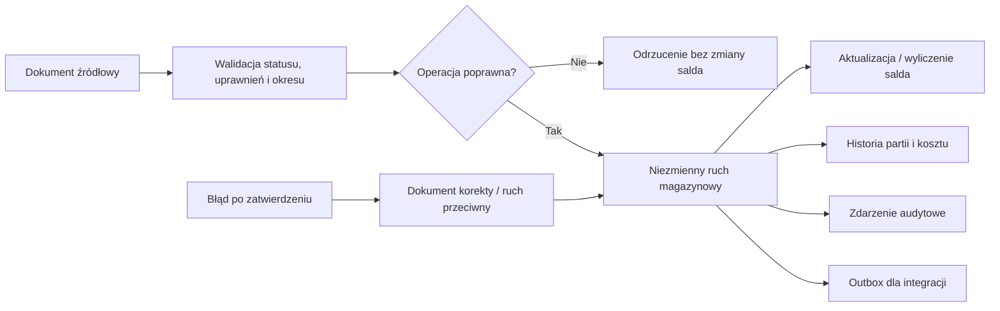
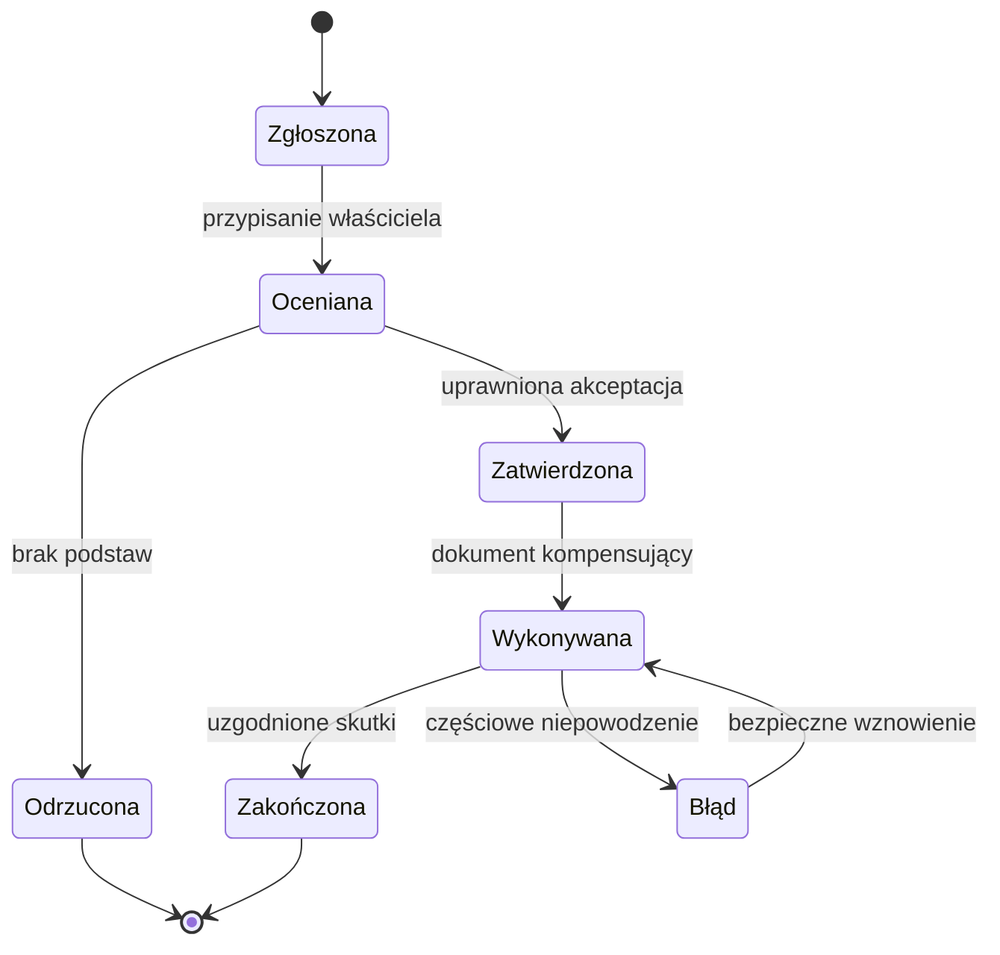
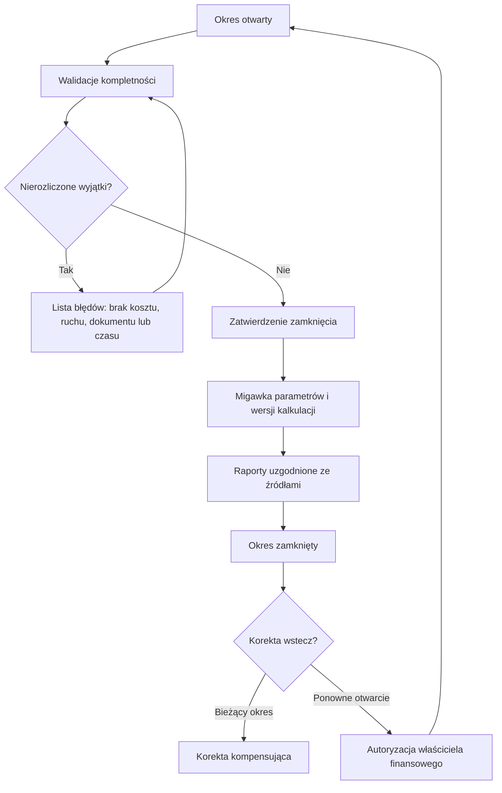
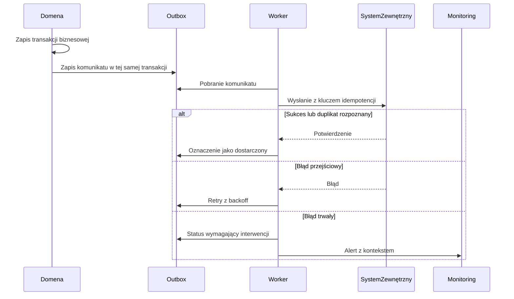

# Diagramy procesów TO-BE

Diagramy pokazują granice odpowiedzialności i kluczowe punkty kontroli. Szczegółowe statusy i wyjątki pozostają wiążące zgodnie z `04_PROCESS_STATE_MACHINES.md` oraz `07_EXCEPTION_AND_CORRECTION_MODEL.md`.

## 1. Krajobraz domen i wspólny rdzeń kontrolny

## 2. Order-to-Cash B2B

## 3. Plan-to-Produce i genealogia partii

## 4. Procure-to-Stock

## 5. Ruch magazynowy jako jedyne źródło zmiany salda

## 6. Uniwersalny model korekty

Każda korekta wskazuje obiekt pierwotny, przyczynę, autora, zatwierdzającego, skutki ilościowe i finansowe oraz identyfikatory zdarzeń kompensujących.

## 7. Zamknięcie okresu i odtwarzalność raportu

## 8. Niezawodna integracja

