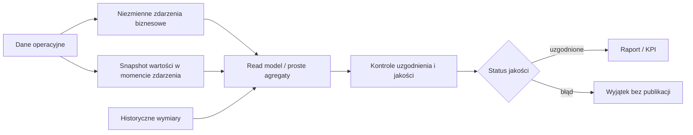

# Minimalny docelowy model danych analitycznych

## Założenie architektoniczne

Na początek wystarczy jedna baza aplikacyjna z wyraźnie oddzielonymi tabelami operacyjnymi, niezmiennymi zdarzeniami i prostymi agregatami. Nie jest potrzebna osobna hurtownia, broker zdarzeń ani rozbudowany ETL. Warunkiem jest stabilna semantyka i możliwość uzgodnienia do źródła.

## 1. Dane operacyjne

Służą do prowadzenia bieżącego procesu i mogą zmieniać status:

| Obiekt | Przykładowe dane | Zasada |
|---|---|---|
| product/customer/supplier/employee | aktualna kartoteka i status | bieżąca wersja; zmiany istotne analitycznie są historyzowane |
| sales_order / purchase_order | bieżący stan zobowiązania i pozycje | kontrolowane przejścia; nie jest sam w sobie faktem sprzedaży/zakupu |
| production_order | plan, recipe_version, status | po release nie zmienia snapshotu receptury |
| inventory_balance | bieżąca projekcja per produkt/magazyn/partia | wynik ruchów, nie niezależne źródło prawdy |
| work_time_entry | roboczy/zaakceptowany czas | dopiero approved zasila koszt i KPI |
| accounting_period | open/closing/closed/reopened | steruje publikacją i korektami |

## 2. Niezmienne zdarzenia biznesowe

| Minimalna tabela/fakt | Ziarno | Najważniejsze powiązania |
|---|---|---|
| `business_event` | jedno zdarzenie domenowe | event ID, typ, aggregate ID/version, business/recorded time, actor, tenant, correlation, idempotency |
| `sales_line_event` | jedna pozycja sale/return/correction | zamówienie, wydanie, dokument, płatność, produkt, klient, sklep, promocja |
| `stock_movement` | jeden zaksięgowany ruch | dokument/linia, produkt, lot, magazyn/lokalizacja, koszt, reversal |
| `production_event` | jedna operacja/ilość/czas | production order, recipe version, input/output lot, employee, shift |
| `cost_entry` | jeden koszt/adjustment | źródło, kategoria, okres, centrum, produkt/partia/sklep/klient |
| `work_time_event` | zatwierdzony czas lub korekta | pracownik, assignment, zadanie/zlecenie, lokalizacja |
| `correction_event` | jedna decyzja kompensująca | original event, delta, reason, actor, approver, period |
| `integration_message` | jedna wiadomość logiczna | event, source/target, version, attempts, external ID i payload hash |

Zdarzenia po zatwierdzeniu nie są aktualizowane ani usuwane. Błąd naprawia zdarzenie kompensujące.

## 3. Snapshoty historyczne

Snapshot można zapisać jako JSON o kontrolowanym schemacie lub jako jawne kolumny faktu. Dla pól często filtrowanych lepsze są kolumny.

| Snapshot | Zakres minimalny |
|---|---|
| product | SKU, nazwa, kategoria, jednostka/przelicznik, opakowanie |
| price/tax | cena bazowa/końcowa, rabat, VAT, waluta/kurs, cennik |
| customer document | nazwa prawna, NIP/VAT ID, adres i kraj wymagane dla dokumentu |
| recipe version | ID/hash wersji, yield, skład i jednostki |
| cost | koszt jednostkowy, metoda, wersja kalkulacji i komponenty |
| employee assignment | employee, rola, stanowisko, lokalizacja obowiązujące w czasie zdarzenia |
| promotion | ID i wersja reguły, finansujący, kwota rabatu |

## 4. Wymiary analityczne

| Wymiar | Model minimalny |
|---|---|
| czas | data, tydzień ISO, miesiąc, rok, dzień tygodnia, godzina i timezone |
| produkt | stabilny product ID + wersje `valid_from/valid_to` dla kategorii/jednostki |
| sklep/lokalizacja | organizacja, zakład, sklep, magazyn, region; wersje obowiązywania |
| klient | stabilny klient, segment/kraj; dane wrażliwe minimalizowane |
| pracownik | pseudonimizowany klucz analityczny + historyczna rola/lokalizacja |
| dostawca | stabilny dostawca, kategoria/ocena i wersja |
| kanał | kontrolowany słownik POS/B2B/online/inny |
| promocja | kampania, mechanizm, okres, finansujący |

Wymiar nie może przepisywać snapshotu faktu. Wersje wymiaru ułatwiają analizę według struktury „wtedy”, a bieżąca kartoteka pozwala analizować „według dzisiejszej klasyfikacji” — raport musi jawnie wybrać jedną perspektywę.

## 5. Agregaty

Agregaty są odbudowywalne i nie stanowią źródła prawdy:

- dzienna sprzedaż per sklep/kanał/produkt;
- dzienne ruchy i saldo końcowe per magazyn/produkt/partia;
- wykonanie produkcji per zlecenie/zmiana;
- miesięczne koszty per centrum/produkt/sklep;
- uzgodnienie dokument–płatność–magazyn;
- rejestr wyjątków jakości danych.

Każdy agregat przechowuje `calculation_version`, zakres danych, czas odświeżenia, watermark i status uzgodnienia. Musi umożliwiać drill-down do zdarzeń.

## Przepływ minimalny

## Kontrakt jakości faktu

Fakt jest gotowy analitycznie, gdy ma:

1. stabilny identyfikator i ziarno;
2. czas biznesowy oraz czas zapisu z timezone;
3. organizację/lokalizację i źródło;
4. aktora albo jawne `system`;
5. snapshot wartości interpretacyjnych;
6. powiązanie z korektą i okresem;
7. klucz idempotencji dla integracji;
8. walidację kompletności i słowników;
9. ścieżkę uzgodnienia do dokumentu/ruchu/płatności;
10. brak fizycznego usunięcia po zatwierdzeniu.

## Moment ewentualnego wydzielenia hurtowni

Osobna hurtownia jest uzasadniona dopiero, gdy raporty obciążają operacje, potrzebna jest integracja wielu niezależnych systemów, retencja analityczna różni się od operacyjnej albo wolumen wymaga partycjonowania niezależnego od ERP. Do tego czasu prosty read model w tej samej bazie ogranicza koszt utrzymania.
