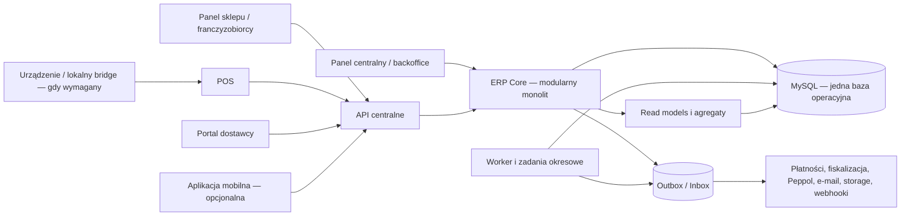
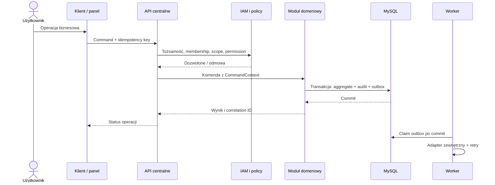

# Docelowa mapa systemu

## Kontekst

## Granice zaufania

| Granica | Zasada |
|---|---|
| klient → API | uwierzytelnienie, organization membership, scope i permission sprawdzane przed komendą |
| moduł → moduł | wyłącznie publiczny interfejs aplikacyjny lub opublikowane zdarzenie; brak zapisu do cudzych tabel |
| ERP → system zewnętrzny | adapter + outbox, timeout, retry i idempotency; sekret z vault/env poza repo |
| system zewnętrzny → ERP | inbox, podpis/token, schema version, deduplikacja przed skutkiem domenowym |
| raport → dane | read-only do read modelu; drill-down do faktu, brak mutacji domeny |
| operator wsparcia → naprawa | kontrolowana komenda korekty z approval; brak bezpośredniego SQL jako normalnej operacji |

## Topologia minimalna

| Element | Liczba logiczna | Skalowanie |
|---|---:|---|
| artefakt ERP web/API | 1 | pionowo; wiele instancji dopiero przy potrzebie, bez sticky state poza sesją |
| worker | 1 typ procesu z różnymi kolejkami logicznymi | konkurencja przez claim/lease; zwiększać liczbę instancji po metrykach |
| MySQL | 1 primary | backup/replica read-only dopiero dla recovery/raportów przy potrzebie |
| storage dokumentów | 1 adapter logiczny | provider wymienny, metadata w ERP |
| broker wiadomości | 0 początkowo | dodać tylko gdy polling outbox nie spełnia SLA/throughput |
| baza analityczna | 0 początkowo | dodać po udowodnionym obciążeniu lub wielu źródłach |

## Przepływ żądania użytkownika

## Zakazane zależności docelowe

- POS, portal, aplikacja mobilna i Agent nie zapisują do tabel ERP;
- raport nie aktualizuje stanu operacyjnego;
- dokument nie jest jedynym źródłem zmiany zapasu;
- moduł nie używa repozytorium tabel innego modułu;
- worker nie odtwarza logiki biznesowej przez ad-hoc SQL;
- integracja nie uznaje timeoutu za pewny brak skutku — sprawdza idempotency/status;
- UI nie przechowuje własnych słowników statusów ani reguł cenowych.
