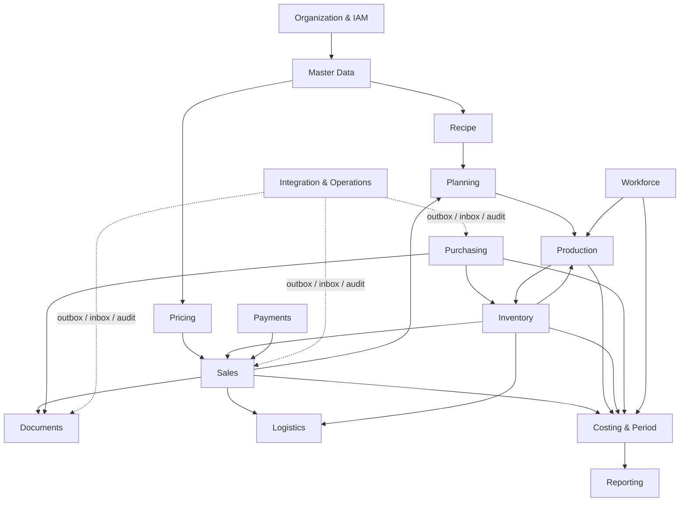

# Granice domenowe

## Reguła granicy

Moduł posiada swoje tabele i jedyny może je zapisywać. Inny moduł korzysta z publicznego interfejsu aplikacyjnego albo z opublikowanego zdarzenia. Wspólna baza nie oznacza wspólnej własności tabel.

## Moduły

| Moduł | Odpowiedzialność i dane | Operacje / publiczne interfejsy | Zależności i właściciel danych | Zdarzenia | Transakcje i dostęp |
|---|---|---|---|---|---|
| Organization & IAM | organizacje, zakłady, sklepy, memberships, users, employees link, roles, grants, sessions | authenticate, authorize, assign/revoke membership, resolve scope | brak domenowych; właściciel: bezpieczeństwo/administracja | UserAuthenticated, MembershipGranted/Revoked, AssignmentChanged | transakcja IAM lokalna; default deny; admin/HR rozdzieleni |
| Master Data | produkt, materiał, jednostka, conversion, package, customer, supplier, warehouse/location metadata | create/update/activate/deactivate, resolve snapshot | Organization/IAM; właściciele kartotek | ProductActivated/Changed, CounterpartyStatusChanged | optimistic lock; aktywnych rekordów nie usuwać; scoped write permissions |
| Recipe | recipe aggregate i immutable versions, ingredients, yield, steps | draft/review/activate/withdraw, get snapshot, validate graph | Master Data; właściciel: technolog | RecipeVersionActivated/Withdrawn | cała wersja atomowa; cycle/overlap check; maker-reviewer permissions |
| Pricing | price lists, VAT rules, promotions, vouchers, exchange rates | quote, publish price, reserve/redeem voucher, get snapshot | Master Data/Organization; właściciel: sprzedaż/finanse | PricePublished, PromotionActivated, VoucherRedeemed | publikacja wersji atomowa; pricing read-only dla innych; approval dla rabatu/reguły |
| Sales | customer order, canonical sale, payment intent state, return/correction case | submit/confirm/fulfil/cancel order; complete/correct sale; request payment | IAM, Pricing, Inventory, Documents; właściciel: sprzedaż | OrderConfirmed/Fulfilled, SaleCompleted/Corrected, PaymentRequested | order/sale lokalnie ACID; stock/payment przez jawne interfejsy/sagę prostą; permissions per kanał |
| Payments | payment attempts, authorization/settlement/refund, provider references | authorize/capture/check/refund | Sales, adapters; właściciel: finanse | PaymentSettled/Failed/Refunded | każda próba własna transakcja; provider poza transakcją DB; idempotency mandatory |
| Documents | invoice/proforma/WDT/WZ/CMR metadata, numbers, immutable snapshots, corrections, delivery status | issue/render/send/correct/cancel draft | Sales/Purchasing/Logistics, Integration; właściciel: finanse/logistyka | DocumentIssued/Sent/Corrected | numer/issue atomowo; render/send po commit; issue/correct restricted |
| Planning | forecast versions, demand, production/purchase plans | create/approve/release/revise plan | Sales, Inventory, Recipe; właściciel: planista | PlanApproved/Released | plan version atomowa; brak bezpośredniej mutacji production order |
| Production | production order, operations, consume/output/waste/QC references, recipe snapshot | create/release/start/report/QC/close/correct | Planning, Recipe, Inventory, Workforce, Costing; właściciel: produkcja/jakość | ProductionReleased/Started/OutputReported/Closed/Corrected | state transition + events atomowo; movements przez Inventory service w tej samej DB transaction orchestration |
| Inventory | immutable movements, balance projection, reservations, transfers, stocktakes, lots | post/reverse movement, reserve/release/consume, transfer, count, lot release/block | Master Data/IAM; konsumenci: Sales/Production/Purchasing | StockMoved, ReservationChanged, LotReleased/Blocked, StocktakePosted | movement+projection+audit atomowo; posted immutable; warehouse/lot permission scope |
| Purchasing | requisition, PO/revision, receipt/discrepancy/claim, supplier score inputs | request/approve/send/acknowledge/receive/claim/close | Master Data, Inventory, Documents, Costing | POApproved/Sent, GoodsReceived, DiscrepancyRaised | PO local transaction; receipt orchestration z Inventory/Costing w jednej DB; approval thresholds |
| Logistics | shipment, lines, custody, carrier, POD, failed/return, transport cost | plan/dispatch/deliver/fail/return | Sales/Purchasing, Inventory, Documents, Costing | ShipmentDispatched/Delivered/Failed/Returned | dispatch/delivery transition atomowa z wymaganym stock/document reference; role logistics |
| Workforce | employee lifecycle detail, schedules, actual time, absences, tasks, labor allocation | schedule, submit/approve/correct time, assign/complete task | IAM/Organization, Production; właściciel: HR/manager | TimeApproved/Corrected, AbsenceApproved, TaskCompleted | time entry local; approved/locked immutable except delta; privacy and manager scope |
| Costing & Period | immutable cost entries, calculation snapshots, allocations, accounting periods, report publications | post/adjust cost, calculate/approve, close/reopen period | wszystkie fakty źródłowe; właściciel: finanse/controller | CostPosted/Adjusted, PeriodClosed/Reopened | cost+adjustment local; close validates all modules synchronously/read-only; dual approval reopen |
| Integration & Operations | outbox/inbox, message attempts, incidents, audit, configuration adapters, health | publish/claim/retry/dead/resolve, query trace | wszystkie moduły; właściciel: IT/operations | MessageDelivered/Failed, IncidentResolved | outbox zapisuje producent; worker claim osobno; ops actions permissioned and audited |
| Reporting | read models, aggregates, definitions, watermarks, reconciliation outcomes | query/export/rebuild/publish | zdarzenia/snapshoty wszystkich modułów; właściciel KPI | ReadModelRefreshed, ReportPublished | read-only do domen; rebuild w osobnej transakcji; publish zależy od jakości/period |

## Kierunek zależności

Strzałka oznacza korzystanie z publicznego kontraktu lub faktu, nie bezpośredni zapis do tabel właściciela.
