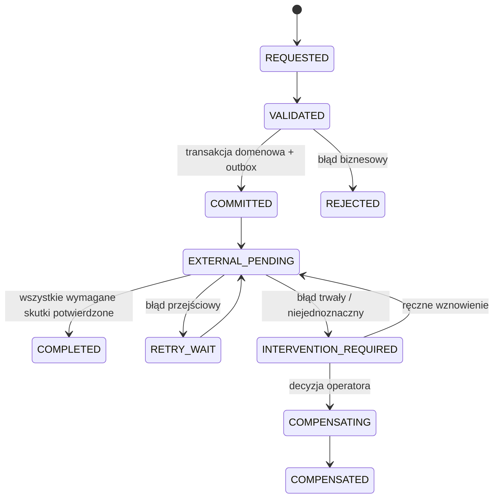

# Model transakcyjny i obsługa błędów

## Model ogólny

System nie używa transakcji rozproszonych. Jedna transakcja MySQL obejmuje zmiany lokalnych aggregate, wymagane wpisy ledger/audit oraz outbox. Wywołania sieciowe, renderowanie i wysyłka następują po commit. Proces wieloetapowy ma trwały stan i jawne kompensacje; nie jest ogólnym workflow engine.

## Procesy krytyczne

| Proces | Granica transakcji i elementy synchroniczne | Po commit | Błąd częściowy | Kompensacja | Retry |
|---|---|---|---|---|---|
| sprzedaż detaliczna | walidacja quote, sale aggregate, snapshot lines, stock issue/reservation consume, audit i outbox w jednej orkiestracji DB; payment state zgodnie z wariantem | fiskalizacja, e-mail, read model, webhook | payment UNKNOWN pozostawia sale PAYMENT_PENDING; commit sale dopiero według BD-01 | return/correction + stock return + refund/document correction | command key per local sale; ten sam key zwraca stan/result |
| zamówienie B2B | state transition, revision, reservation request/result, audit/outbox | dokument, powiadomienie, plan read model | brak pełnej rezerwacji daje explicit shortage/partial, nie silent success | cancel/release reservation; po fulfilment correction/return | order command ID + expected version |
| ruch magazynowy | movement, balance projection/version, lot genealogy, audit/outbox atomowo | reporting/alerts | konflikt salda/version powoduje rollback całej komendy | reversal movement; brak update/delete posted | source line+effect/idempotency unique |
| transfer | utworzenie transferu; każde PICK/RECEIVE atomowo z odpowiadającym ruchem | notification | po PICK przed RECEIVE stan IN_TRANSIT; błąd odbioru nie cofa pick | cancel przed pick; po pick return/reverse/discrepancy | command key per transition |
| produkcja | transition order + execution event + wymagane stock movements + labor reference/audit w jednej DB transaction orchestration | agregaty, dokumenty, alert QC | output nie może być committed bez stock movement; adapter/raport może później retry | correction events, reverse/delta movements/cost adjustment; reopen controlled | order+operation+client event ID unique |
| płatność | utworzenie attempt/intention w DB | provider call; webhook/status result zapisuje kolejny state transition | timeout = UNKNOWN; nie oznaczać FAILED ani ponawiać capture w ciemno | refund/void/chargeback jako osobne attempt/event | merchant/provider idempotency key; status check before retry |
| zakup i przyjęcie | PO transition lokalnie; receipt + stock movement + provisional cost + discrepancy atomowo | supplier message/document/read model | częściowa dostawa jest stanem; failure stock/cost rollback całego receipt | return/reversal/claim i cost adjustment | supplier delivery ID + receipt line key |
| POS sync | inbox insert/dedupe i walidacja; zastosowanie SaleSubmission osobną transakcją | fiskalizacja/notifications według polityki | REJECTED/CONFLICT zachowuje payload i reason; operator rozwiązuje | corrected submission jako nowa version/correction, nie edit payload | `(shop,device,local_sale_id)` i message ID |
| dokument | validate source + reserve/assign number + immutable document snapshot + outbox atomowo | render, storage, send/Peppol | render/send failure nie unieważnia issued document; widoczny status | correction document; failed draft można cancel bez reuse numeru | document+version+channel key |
| korekta | correction case approval + correction event + wszystkie lokalne delty/ledger entries atomowo w DB | external refunds/documents/messages | jeśli zewnętrzny skutek fail, case pozostaje PARTIALLY_APPLIED z incident; local facts nie znikają | dalsza kompensacja lub retry adaptera; manual verified completion | correction ID stable; każdy effect ma unique `(correction,effect_type)` |

## Wzorzec persisted orchestration

Nie każdy proces potrzebuje wszystkich stanów. Wzorzec stosuje się tylko tam, gdzie po lokalnym commit występuje wymagany skutek zewnętrzny.

## Klasy błędów

| Klasa | Przykład | Zachowanie |
|---|---|---|
| validation/business | brak ceny, niedozwolony status, shortage | rollback/brak zapisu poza audytem odmowy; użytkownik dostaje przyczynę |
| concurrency | expected version mismatch, duplicate number | rollback i 409/conflict; świadome ponowienie |
| transient technical | timeout, 503, lock timeout | bounded retry z backoff i tym samym key |
| ambiguous external | payment/fiscal timeout po wysłaniu | stan UNKNOWN, status lookup/reconciliation przed kolejną mutacją |
| permanent external | invalid contract, rejected invoice | dead/intervention state, bez automatycznego endless retry |
| data quality | orphan/missing snapshot | blokada publikacji/close; incident z ownerem |
| partial legacy migration | różnica old/new read | nie przełączać; zapisać mismatch i utrzymać stary read |

## Locking i konkurencja

- optimistic version dla aggregate i konfiguracji;
- unique constraints dla numerów, source references i idempotency keys;
- row-level lock tylko dla krótkich sekcji krytycznych salda/numeracji;
- claim/lease z timeoutem dla workerów;
- brak transakcji obejmującej wywołanie sieciowe;
- powtórzenie po deadlocku tylko na granicy całej idempotentnej komendy.
