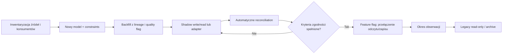

# Strategia migracji

## Zasada

Migracja odbywa się zdolność po zdolności, nie aplikacja po aplikacji. Każda większa zmiana przechodzi: inventory → adapter/baseline → backfill → shadow/read comparison → kontrolowany cutover → obserwacja → deprecation. Stare dane pozostają read-only do końca retencji lub potwierdzonej archiwizacji.

## Wzorzec bezpiecznego przełączenia

Dual write stosuje się tylko, gdy adapter lub jeden application service może zagwarantować oba skutki i zapisać mismatch. Nie wolno dodawać dwóch niezależnych wywołań z kontrolera/klienta. Preferowany jest pojedynczy zapis do nowego modelu + outbox/projection legacy albo odwrotnie w okresie przejściowym.

## Większe zmiany

| Zmiana | Bez przestoju / zapis równoległy | Backfill | Walidacja i przełączenie odczytu | Wycofanie / rollback |
|---|---|---|---|---|
| schema baseline i migracje | najpierw tylko metadata; runner stosuje additive changes | mapa istniejącego schematu/checksum | czysta baza + upgrade test + schema diff | rollback przez backup/forward fix; nie usuwać kolumn w tej samej zmianie |
| IAM/RBAC/tenant | dodać canonical user/membership/grant obok legacy auth; legacy sesje czasowo mapowane | konta, role, scope z raportem konfliktów | shadow authorization loguje różnice bez odmowy, potem feature flag per route | powrót policy flag do legacy przy zachowaniu nowych auditów; rotacja po finalnym cutover |
| master data/historia | additive canonical IDs/version columns; legacy CRUD przez adapter | produkty/materiały/kontrahenci z legacy ID map | count/duplicate/orphan i porównanie ekranów; read switch per kartoteka | adapter czyta legacy; nowe revisions zachować, nie kasować |
| recipe versions | przy pierwszej zmianie tworzyć migrated baseline version; legacy read adapter | każdy aktualny graf → version 1 z `reconstructed`/hash | kalkulacja i graf porównane; nowe zlecenia wskazują version | feature flag do starego odczytu tylko dla legacy obiektów; nowych wersji nie cofać |
| pricing/history | publikacja nowych wersji równolegle z legacy current price projection | bieżąca cena jako version start; changelog jeśli wiarygodny | quote comparison i overlap/null checks; switch per kanał | projection legacy może pozostać; canonical versions zachować |
| canonical sale | adapter przyjmuje WDT/POS/order source; shadow fact nie zasila finansów na początku | zamknięte okresy jako reconstructed facts z source quality | reconciliation source totals/lines/corrections; switch raportów i nowych sales | odczyt raportu wraca do legacy flag; canonical facts pozostają, nowe corrections kompensują |
| POS sync | centralny inbox przyjmuje kopię komunikatu, bez drugiego skutku domenowego w shadow | mapping shop/device/local IDs i nieprzetworzone kolejki | duplicate/retry/offline scenarios i totals per day | zatrzymać consumer, pozostawić inbox; klient może wrócić do poprzedniego endpointu czasowo |
| stock ledger | legacy writes emitują movement adapter lub są zamykane od cutover; nie rekonstruować fałszywej historii | zatwierdzony balance opening per product/location/lot z lineage; historyczne ruchy tylko jeśli kompletne | ledger sum = projection/physical count; parallel reconciliation per day | przed write cutover powrót do legacy; po cutover tylko forward fix/reversal, nie usuwać movements |
| production order/execution | nowe zlecenia w canonical model; stare listy pozostają planem/read-only | otwarte rzeczywiste zlecenia tylko z potwierdzonym stanem, reszta legacy reference | pilot shadow list vs plan; movement/cost/QC reconciliation | nowe order można pause/cancel zgodnie z domeną; UI flag wraca, dane zachowane |
| purchasing/receipt | adapter legacy document → PO/receipt; nowe PO per feature flag | otwarte PO/dostawy z mappingiem; zamknięte jako archive/reconstructed | supplier/qty/price/status totals i partial receipt E2E | nowe receipts nie wracają do legacy edit; feature flag dla nowych PO, compensation dla skutków |
| dokumenty/faktury | jeden numbering service; stary renderer może renderować canonical snapshot | metadata/numery/historyczne pliki i links | number uniqueness, totals/tax/hash i correction chain | renderer/channel można cofnąć; issued canonical document pozostaje ważny |
| cost ledger/period | istniejące cost_month zapisują source entries przez adapter lub import batch | okresy jako estimated/reconstructed; brakujące koszty = INCOMPLETE | sumy source→entry→allocation→report, zamknięty okres porównawczy | raport flag wraca do legacy; posted entries tylko adjustment, nie delete |
| workforce/time | canonical employee mapping, grafik pozostaje osobno; actual time tylko od daty kontrolnej | user/employee/assignment; nie backfill actual z grafiku | active employee totals, permissions/privacy i payroll/cost reconciliation | time collection można wstrzymać; zatwierdzonych wpisów nie kasować |
| outbox/inbox | wspólny envelope; adaptery starych kolejek publikują/claimują stopniowo | pending/dead messages z original IDs/status | one-effect duplicate test, backlog counts, delivery SLA | worker per adapter feature flag; wiadomości pozostają i mogą być wznowione starym workerem |
| reporting read models | równoległe zapytania old/new na tych samych okresach | incremental rebuild od kontrolnej daty | definicja, totals, drill-down, performance i owner sign-off | szybki read feature flag; agregaty odbudowywalne/usuwalne, fakty nietknięte |

## Walidacja migracji

Każdy batch zapisuje: source system/table, source ID, canonical ID, transform version, migrated at, status, rejection reason i checksum. Raport obejmuje count source/accepted/rejected, duplicate/orphan/null, sumy ilości/kwot, min/max dates oraz próbkę trace do dokumentu.

## Rollback

- przed write cutover: wyłączyć nowy consumer/read flag i poprawić backfill;
- po write cutover: nie przywracać starego zapisu do tych samych faktów bez formalnej decyzji; użyć kompensacji/forward migration;
- external effects nie są cofane przez rollback kodu — wymagają domenowej korekty;
- destructive schema changes następują dopiero po okresie obserwacji, backup/restore test i potwierdzeniu braku odczytów;
- każdy feature flag ma ownera, zakres, datę usunięcia i monitoring obu ścieżek.

## Migracja bez pełnego dual write

Gdy dual write jest ryzykowny, preferować cutover granicą czasu lub nowego obiektu: stare zamówienia kończą się w legacy, nowe powstają w canonical; stare okresy są read-only, nowy okres używa cost ledger; bieżące saldo staje się opening balance, a nowe ruchy budują historię od daty kontrolnej.
