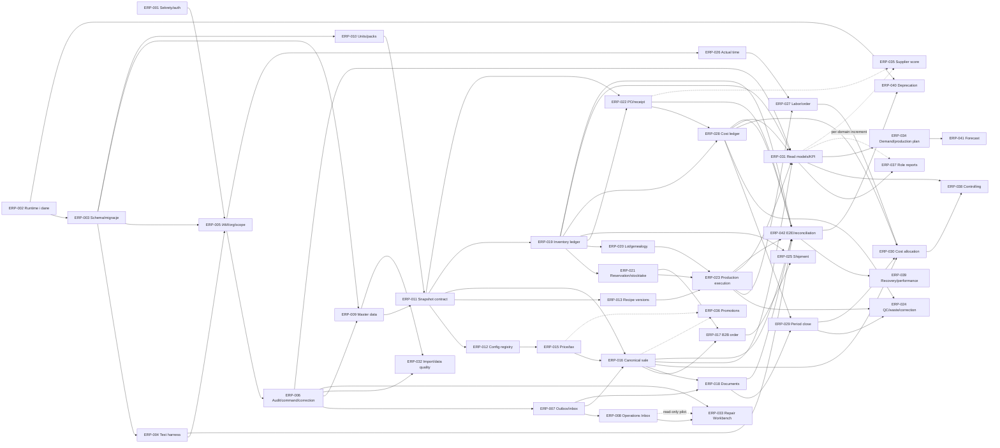

# Graf zależności

## Graf główny

Krawędź ciągła oznacza zależność twardą; przerywana — miękką lub możliwość wcześniejszego pilota read-only. Węzły raportowe są świadomie na końcu łańcuchów faktów.

## Rejestr zależności per inicjatywa

`H` — hard, `M` — soft; `∥` wskazuje bezpieczną możliwość pracy równoległej. Konflikt oznacza konkurencyjny model albo decyzję, nie konflikt personalny.

| ID | H | M | Odblokowuje | Konflikt / uwaga | ∥ |
|---|---|---|---|---|---|
| ERP-001 | — | — | 005/007 i bezpieczna konfiguracja adapterów | stare login/secrets | 002 |
| ERP-002 | — | — | 003/007/040 i decyzje reuse | brak dostępu/deployment ownera | 001 |
| ERP-003 | 002 | — | prawie wszystkie modele/migracje | ręczne migracje bez baseline | 001, decyzje BD |
| ERP-004 | 003 | — | bezpieczne zmiany i 042 | wdrażanie domen bez test DB | małe discovery |
| ERP-005 | 001/002/003/004 | BD-10 | wszystkie UI/komendy | legacy permission/JWT/sessions | model org może powstać obok harnessu |
| ERP-006 | 003/004/005 | BD-07/09/15 | korekty, audit, self-service | lokalne changelogi/direct update | inwentaryzacja eventów |
| ERP-007 | 001/002/003/004/006 | — | 008/016/018/022 | wiele outboxów/statusów | adapter po adapterze |
| ERP-008 | 005/006/007 | ownership/SLA | 033, niższy MTTR | osobne retry UI | read-only wcześniej po 006 |
| ERP-009 | 003/005/006 | data owners | 011–017/020/022/032 | duplikaty App/Agent | kartoteka po kartotece |
| ERP-010 | 003/006 | BD-03 | 011/013/019/022/023 | zmiana użytych przeliczników | analiza z 009 |
| ERP-011 | 003/004/006/009/010 | — | fakty i reporting | bieżące joiny przepisywania historii | kontrakt równolegle z 009/010 |
| ERP-012 | 005/006/009 | ownerzy polityk | 015/018/config self-service | `.env`, kod i alias CRUD | słowniki po domenach |
| ERP-013 | 003/004/006/009/010/011 | BD-04 | 014/023/034 | edytowalna bieżąca receptura | pilot jednej rodziny receptur |
| ERP-014 | 013/015/028 | metoda kosztu | koszt normatywny/controlling | zero/1 jako fallback | po stabilizacji inputów |
| ERP-015 | 006/009/010/011/012 | BD-06/11 | 014/016/018/036 | obecne ceny bez pełnej historii | ceny i podatki oddzielnie |
| ERP-016 | 005/006/007/009/010/011/015 | BD-01/11/12 | 017/018/025/030/031/038 | WDT/POS/order/invoice jako konkurenci | kanał B2B przed POS po decyzji |
| ERP-017 | 005/006/009/010/011/015/019/021 | BD-08 | 025/034 | CRUD status/happy path | state machine przed pełnym UI |
| ERP-018 | 005/006/007/011/012/016 | BD-01/07/11 | 025/029/042 | dwie rodziny faktur | renderer może być adapterem |
| ERP-019 | 002/003/004/005/006/009/010/011 | BD-02/06 + opening count | 020–025/028–031 | `carton_stock` vs Agent inventory | shadow ledger jednej lokalizacji |
| ERP-020 | 009/010/011/019 | BD-03/05 | 021–024/030 | koszt pełnego lot coverage | klasy ryzyka etapami |
| ERP-021 | 005/006/019/020 | BD-02/07/09 | 017/023/029/033 | arbitralny update salda | reservation i stocktake osobno |
| ERP-022 | 005/006/007/009/010/011/015/019 | BD-14 | 028/035/042 | dwa modele zakupowe | receipt vertical slice |
| ERP-023 | 005/006/009/010/011/013/019/020/021 | BD-04 | 024/027/030/031/042 | lista produkcyjna jako „zlecenie” | pilot zakładu/produktu |
| ERP-024 | 006/020/023/028/029 | BD-05/07/09 | traceability i koszt strat | Agent waste jako source | QC i waste etapami |
| ERP-025 | 006/007/016/017/018/019 | BD-08 | koszt dostawy/OTIF | dokument ≠ custody | POD adapter równolegle |
| ERP-026 | 005/006/011 | BD-13/15 | 027/031 | grafik ≠ actual | identity mapping przed RCP |
| ERP-027 | 023/026 | BD-13 | 030/031 | nadmierna szczegółowość czasu | jedna operacja pilotażowa |
| ERP-028 | 003/006/011/015/019/022 | BD-06 | 014/024/029/030/038 | `cost_month` jako ledger | source type po source type |
| ERP-029 | 006/018/019/021/028 | BD-07/09 | 024/030/038 | prosty unlock bez konsekwencji | checklist read-only wcześniej |
| ERP-030 | 016/020/023/025/027/028/029 | BD-06 | 038 | pozorna dokładność alokacji | metoda po obiekcie kosztowym |
| ERP-031 | 006/011 + fakt domeny | KPI definitions | 034–038/041 | dashboardy legacy/WDT | read model per vertical slice |
| ERP-032 | 003/005/006/009/010/011 | stewardship | lepsza migracja i mniej SQL | uniwersalny import bez schematu | export/read-only wcześniej |
| ERP-033 | 005/006/008 + commands | progi approval | redukcja SQL | uniwersalne set-status | case shell równolegle, akcje później |
| ERP-034 | 009/013/017/019/021/023/031 | BD-04/08 | 041 | plan mylony z forecastem | manual plan przed automatyzacją |
| ERP-035 | 009/022/031 | BD-14 | sourcing decisions | ręczny score bez faktów | definicja KPI wcześniej |
| ERP-036 | 015/016/031 | campaign policy | analiza promocji | rabat bez baseline cost | definicja reguł wcześniej |
| ERP-037 | 031 + domain facts | user research | decyzje operacyjne | obecne niewiarygodne dashboardy | raport po domenie |
| ERP-038 | 016/028/029/030/031 | finance sign-off | rentowność | kalkulacja na current recipe | definicje wcześniej |
| ERP-039 | 003/004/007/019/042 | SLA/budgets | bezpieczna skala | optymalizacja bez pomiaru | test restore można wcześniej |
| ERP-040 | 002/003/006 + replacements | BD-15 | niższy maintenance | usunięcie przed dowodem braku użycia | analiza kandydatów stale |
| ERP-041 | 031/034 + historia | model owner | prognozowanie | brak jakościowych danych | eksperyment offline po gate |
| ERP-042 | 004 + kolejne facts | controlled docs | gates 039/040/release | „testy na końcu” | rośnie razem z każdą domeną |

## Fundamenty i zadania startowe

Fundamenty: ERP-001–007, ERP-010/011 i ERP-042. Bez zależności startują tylko ERP-001 i ERP-002; warsztaty decyzji BD oraz inwentaryzacja test cases mogą biec równolegle, ale nie są osobną implementacją.

