# Ścieżka krytyczna

## Ścieżka programu

```mermaid
flowchart LR
    A["ERP-002 Discovery"] --> B["ERP-003 Schema + profile"]
    B --> C["ERP-004 Harness"]
    C --> D["ERP-005 IAM/scope"]
    D --> E["ERP-006 Audit/correction"]
    E --> F["ERP-011 Snapshots"]
    F --> G["ERP-019 Inventory ledger"]
    G --> H["ERP-022 Receipt"]
    H --> I["ERP-028 Cost ledger"]
    I --> J["ERP-029 Period close"]
    J --> K["ERP-030 Allocation"]
    K --> L["ERP-031 Read models"]
    L --> M["ERP-038 Controlling"]
```

Równoległa gałąź sprzedażowa `ERP-015 → ERP-016 → ERP-018` łączy się z cost/period w `ERP-030/038`. Gałąź produkcyjna `ERP-013 → ERP-023 → ERP-024/027` również łączy się w alokacji kosztu. `ERP-042` nie jest ostatnim etapem: rozszerza się na każdym pionowym fragmencie i stanowi bramę jego wydania.

## Dlaczego ta ścieżka

- Schema/profile poprzedza migrację, bo obecny schemat nie ma potwierdzonego baseline.
- IAM/audit poprzedzają operacje biznesowe, aby od pierwszego nowego faktu zapisać aktora, scope i korektę.
- Snapshot poprzedza fakty, bo późniejszego historycznego stanu ceny/receptury nie da się wiarygodnie odtworzyć.
- Inventory/receipt/cost tworzą nieodtwarzalne dane wejściowe do wyceny.
- Period i reconciliation poprzedzają controlling, bo inaczej raport zmienia się wstecz.

## Wąskie gardła i działania ograniczające

| Wąskie gardło | Skutek | Działanie |
|---|---|---|
| nieznany runtime Agent | zła decyzja reuse/replace | ERP-002: owner, traffic, cron, DB reads/writes |
| brak profilu DB | nieznany koszt migracji | read-only metadata/count/DQ przed schematem docelowym |
| BD-01/02/06/07/10 | blokada modeli source of truth | timeboxed warsztaty i ADR z ownerem |
| opening stock | ledger nie ma wiarygodnego początku | kontrolna inwentaryzacja, lineage i sign-off |
| brak dokumentu/okresu kontrolnego | brak reconciliation | wybrać jeden zamknięty okres i zestaw dokumentów |
| dostępność ownerów do UAT | techniczny „done”, brak procesu E2E | rezerwować UAT przed rozpoczęciem pakietu |
| jedna osoba, wiele domen | context switching i niedomknięte slice’y | WIP=1 dla mutacji, stała checklista DoD |

## Pozornie pilne, ale przedwczesne

- dashboard marży/rentowności przed ERP-016/028–031;
- forecast przed wersjonowanym planem i historią jakościową;
- supplier score przed receipt/discrepancy facts;
- globalny Repair Workbench przed komendami korekt domenowych;
- pełny WMS/skanowanie przed ledgerem, jednostkami i partiami;
- automatyczny koszt receptury przed temporalnymi cenami i cost ledger;
- deprecacja Agent przed potwierdzeniem runtime i migracją konsumentów.

## Funkcje wymagające migracji

Najwyższe ryzyko migracji mają ERP-003, 005, 009–011, 013, 015–020, 022–023, 026, 028 i 040. Każda wymaga inventory → backfill z lineage → shadow compare → kontrolowany cutover → obserwacja → legacy read-only. Po write cutover stosować forward correction, nie powrót do dwóch źródeł zapisu.

