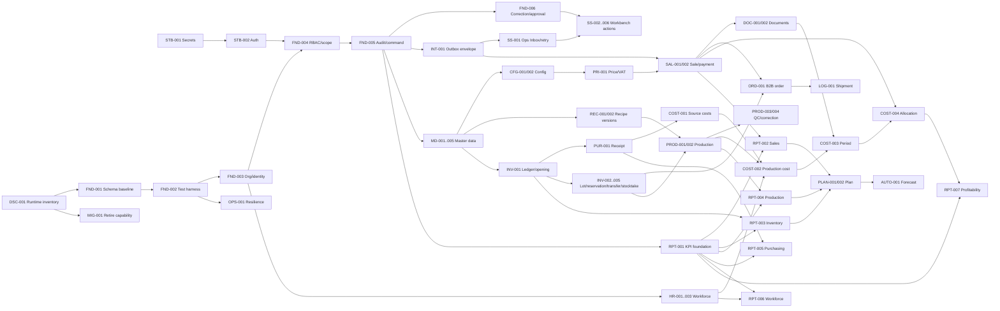

# Zależności pakietów

## Graf główny

## Zależności twarde pierwszej fali

| Pakiet | Twarde | Miękkie/decyzyjne | Odblokowuje |
|---|---|---|---|
| STB-001 | dostęp/owner credentials | DSC-001 równolegle | STB-002, bezpieczne adaptery |
| STB-002 | STB-001, aktywny entrypoint z DSC-001 | przyszły IAM design | FND-004, bezpieczny UAT |
| DSC-001 | dostęp read-only i właściciele | — | FND-001/003/INT-001/MIG-001 |
| FND-001 | DSC-001 | DBA sign-off | FND-002 i każda migracja |
| FND-002 | FND-001 | control documents | wszystkie pakiety wykonawcze |
| FND-003 | FND-001/002, BD-10 | HR/data owners | FND-004, master data scopes |
| FND-004 | STB-002, FND-003, BD-09/10 | route usage | FND-005 i wszystkie UI/commands |
| FND-005 | FND-002/004, BD-15 | wybór pilot command | FND-006, INT-001, reporting/self-service |
| FND-006 | FND-005, BD-07/09 | pilot domain | legal corrections i Repair Workbench |
| INT-001 | STB-001, DSC-001, FND-001/002/005 | owner kolejki | SS-001 i external effects |
| SS-001 | FND-004/005, INT-001 | support owner/SLA | wspólny self-service/MTTR baseline |

## Łańcuchy krytyczne domen

- Receipt: `MD-003/004/005 + PRI-001 → INV-001 → PUR-001 → COST-001 → RPT-005`.
- Sale: `MD-001/002 + PRI-001 + INT-001 → SAL-001 → SAL-002/DOC-001 → DOC-002 → RPT-002`.
- Production: `REC-002 + INV-002/003 → PROD-001 → PROD-002 → PROD-003/004 → COST-002 → RPT-004`.
- Profitability: `SAL-001 + COST-001/002 → COST-003 → COST-004 → RPT-001/007`.
- Planning: `RPT-002/003/004 + ORD-001 + PROD-001 → PLAN-001 → PLAN-002 → AUTO-001`.

## Bezpieczna równoległość

- `STB-001` i read-only `DSC-001`.
- Podczas FND-001 można przygotować business decisions i fixtures, ale nie drugi schema cutover.
- Po FND-005 master-data discovery może biec obok migracji jednego outboxu.
- Po F2 receipt i sale mogą być osobnymi przyszłymi workstreamami tylko przy więcej niż jednym wykonawcy; dla jednej osoby WIP=1.
- Reporting definition może powstawać wcześniej, lecz implementacja/publikacja czeka na source fact i reconciliation.

## Konflikty

- STB-002 nie może utrwalać drugiego IAM zamiast przygotować FND-004.
- FND-003/004 nie mogą tworzyć niezależnych organization IDs w App i Agent.
- INT-001 nie może użyć nowego message ID dla retry tego samego skutku.
- INV-001 nie może współistnieć z drugim writerem salda po cutoverze.
- RPT-007 nie może użyć current recipe/price ani `cost_month` jako pełnej prawdy.

