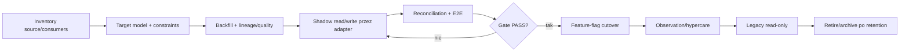

# ERP Migration Strategy

## Zasady nadrzędne

Migracja odbywa się zdolność po zdolności, nie „App do nowego ERP” jako całość. Nowy model jest additive; stare dane pozostają read-only do końca obserwacji/retencji. Nie kasować danych ani wyłączać Agent na podstawie braku referencji w repo.

## Wzorzec cutoveru

## Fazy techniczne migracji

1. **Inventory:** routes/DI/cron/traffic, DB reads/writes, data counts, owner, retention.
2. **Target:** schema, constraints, version columns, canonical IDs, permission/audit.
3. **Backfill:** immutable batch manifest, transform version, lineage, rejects, quality flags.
4. **Shadow:** jeden application service/adapter; mismatch zapisywany i monitorowany.
5. **Reconciliation:** counts/sums/hash/min-max, business control totals i trace samples.
6. **Cutover:** scope/time/new-object boundary, feature flag, runbook, backup, rollback plan.
7. **Observe:** SLA/errors/backlog/mismatch i user sign-off.
8. **Retire:** zero traffic/read/write, legal/retention, archive/restore, usunięcie flagi.

## Strategia per capability

| Zdolność | Granica migracji | Backfill | Cutover/rollback |
|---|---|---|---|
| schema | environment po środowisku | baseline/checksum | forward migrations; restore only under runbook |
| IAM/org | route/scope | users/employees/grants z conflict report | shadow authorization, route flags; powrót do legacy policy przed final cutover |
| master data | kartoteka/typ | canonical ID + aliases/revisions | read switch per registry; new revisions retained |
| recipe | rodzina receptur | current graph→reconstructed v1 | nowe orders tylko RecipeVersion; legacy read dla starych |
| prices/tax | cennik/channel | current as first version, verified history only | effective-date publish; issued facts unchanged |
| sale/POS | channel/control date | closed periods reconstructed if reconciled | new sales to canonical; old orders finish legacy; corrections forward |
| documents | doc type/channel | metadata/number/hash/correction links | canonical snapshot + legacy renderer adapter; issued immutable |
| inventory | location/product class/control date | signed opening balance; history only if complete | single writer at boundary; after cutover reversal/adjustment only |
| purchasing | new PO or site | open PO/receipts with mapping | new PO/receipt canonical; old finish legacy |
| production | new production order/site/product | only open orders with confirmed state | new orders canonical; old lists reference/archive |
| workforce | control date/site | user/employee/assignment; no actual from schedule | actual time from date; approved entries immutable |
| cost/period | new period or source type | old periods reconstructed/estimated | source adapters one by one; posted entry adjusted, not deleted |
| integration | producer/consumer | pending/dead with original IDs/status | worker/adapter flag; envelope preserved |
| read model | KPI/scope/control date | rebuild from facts | read feature flag; projection rebuild/rollback safe |

## Dual write

Preferowany jest pojedynczy zapis do canonical model + outbox/projection legacy albo legacy command adapter emitujący canonical event. Dwa niezależne wywołania z kontrolera/klienta są zakazane. Jeśli drugi skutek nie powiedzie się, retry używa stable idempotency key; mismatch jest widoczny i ma ownera.

## Rollback i forward correction

- przed write cutover: wyłączyć consumer/read flag, naprawić model/backfill i powtórzyć reconciliation;
- po write cutover: nie przywracać drugiego writera do tych samych faktów; stosować reversal/correction/forward migration;
- efekt zewnętrzny nie cofa się rollbackiem kodu — wymaga domenowej kompensacji;
- destructive DDL/purge dopiero po observation, zero-use evidence i restore test.

## Dane i dowody

Batch: source/table/ID, target ID, transform version, status/rejection, migrated_at, checksum, quality flag. Raport: source/accepted/rejected counts, duplicate/orphan/null, sumy ilości/kwot/VAT, min/max dates, sample trace i sign-off ownera. Brak reconciliation oznacza brak zgody na cutover.

## Feature flags

Każda flaga ma ownera, scope, domyślny stan, telemetrykę obu ścieżek, datę/warunek expiry i plan usunięcia. Flaga nie może utrzymywać dwóch writerów bez limitowanego okresu i mismatch monitoringu.

## Deprecation

Warunki: zastępczy proces E2E PASS, dane zmigrowane/archiwalne, brak ruchu/cron/DI/DB access przez uzgodnione okno, konsumenci zewnętrzni potwierdzeni, retencja/legal hold, backup/restore. Najpierw logiczne odłączenie/read-only, później usunięcie kodu, a dane zgodnie z retencją.

