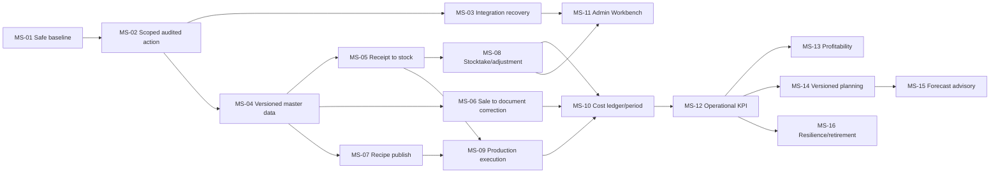

# ERP Roadmap

## Zasada

Roadmapa jest sekwencją bram, nie obietnicą dat. Faza może być realizowana tylko w zakresie, dla którego spełniono wejście. Self-service, testy, migracja i reporting nie są osobnymi końcowymi projektami: rosną wraz z pionowymi procesami.

## Mapa faz i inicjatyw

| Faza | Outcome | Inicjatywy główne | Brama końcowa |
|---|---|---|---|
| F0 Stabilizacja dowodów | znany i zabezpieczony system | ERP-001/002 | sekret/auth zabezpieczone; runtime/data inventory z dowodem |
| F1 Trust & safe change | bezpieczna, testowalna komenda i niezawodna integracja | ERP-003–008/042 | CI, deny-by-default, audit trace, one-effect retry PASS |
| F2 Dane i historia | wersjonowane kartoteki/receptury/ceny/snapshoty | ERP-009–015/032 slice | historical stability i import reconciliation PASS |
| F3 Operacje E2E | receipt/stock, sale/document i production execution jako fakty | ERP-016–027 | minimum trzy vertical slices z correction/reconciliation |
| F4 Self-service | operator/admin rozwiązuje zatwierdzone klasy spraw | ERP-008/012/032/033 | wybrane klasy bez SQL/programisty, controls PASS |
| F5 Analityka operacyjna | pierwsze KPI `AVAILABLE` | ERP-031/035/037 | fact+correction+snapshot+DQ+reconciliation+drill-down |
| F6 Cost & profitability | zamknięty, odtwarzalny koszt i marża | ERP-014/028–030/038 | control period stable i totals reconciled |
| F7 Plan/automatyzacja | versioned plan, advisory forecast i kontrolowane retire | ERP-034/039–041 | plan-vs-actual, backtest, recovery i retire gates |

## Kolejność milestone’ów

## Release trains dla jednej osoby

Nie planować więcej niż jednego mutującego milestone’u naraz. Kolejny może być w discovery/UAT preparation, gdy poprzedni jest w okresie obserwacji. Każdy milestone dzieli się na:

1. decyzja i control pack;
2. additive model/constraints;
3. application command + permission/audit;
4. UI/API właściwego aktora;
5. backfill/shadow/reconciliation;
6. correction/retry E2E;
7. cutover, obserwacja i retire starej ścieżki.

## Bramki programu

- Nie rozpocząć F2 przed schema/test/IAM/audit core.
- Nie przełączyć F3 bez control data i correction path.
- Nie udostępnić mutującego self-service bez permission/preview/audit/compensation.
- Nie opublikować KPI bez statusu `AVAILABLE` dla konkretnego zakresu/okresu.
- Nie uruchomić controlling bez zamkniętego control period.
- Nie uruchomić forecast bez manual baseline i jakościowej historii.

## Replanowanie

Po F0 przeliczyć koszt/migrację/niepewność inicjatyw. Po każdym vertical slice zaktualizować wolumeny, defect rate, support load i koszt utrzymania. Zmiana kolejności receipt vs sale jest dozwolona, jeśli control pack i koszt incydentów wskazują inny pierwszy slice; fundamentów F0–F2 nie można ominąć.

