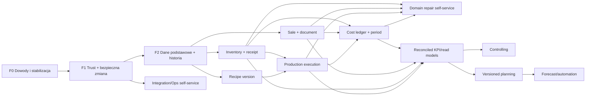

# ERP Transformation Master Plan

## Status i zasady użycia

Ten dokument jest nadrzędnym źródłem prawdy dla modernizacji ERP. Rejestr `ERP-001`–`ERP-042` z `planning/06-prioritization/01_UNIFIED_BACKLOG.md` pozostaje źródłem identyfikatorów inicjatyw, a niniejszy plan rozstrzyga kolejność, bramy i sposób dostarczania. W razie sprzeczności pierwszeństwo mają: potwierdzony dowód runtime/danych, decyzja właściciela zapisana w `ERP_DECISION_REGISTER.md`, następnie zasady integralności tego planu. Zmiana planu wymaga datowanej decyzji i aktualizacji zależnych dokumentów.

Plan nie jest harmonogramem ani instrukcją implementacyjną. Daty powstaną dopiero po F0, gdy znane będą deploymenty, profil bazy, liczba użytkowników, wolumeny i dostępność właścicieli do UAT.

## 1. Cel biznesowy

Przekształcić obecny zbiór funkcji ERP w system, który wiarygodnie obsługuje sprzedaż, zakup, magazyn, produkcję, dokumenty, pracę i koszt — od zdarzenia źródłowego do raportu — bez rutynowego SQL, bez przepisywania historii i bez podwójnego skutku integracji.

Mierzalny efekt programu:

- krytyczne procesy kończą się, korygują i anulują zgodnie z regułami domeny;
- każdy stan finansowy, magazynowy i produkcyjny da się wyjaśnić dokumentem/zdarzeniem;
- uprawnienie jest egzekwowane centralnie z zakresem organizacyjnym;
- awaria integracji nie powoduje cichej utraty lub duplikatu;
- administrator wykonuje bezpieczne operacje przez self-service z audytem;
- KPI mają definicję, canonical fact, snapshot, korekty, jakość i reconciliation;
- spada liczba interwencji programisty i czas diagnozy.

## 2. Zakres systemu

W zakresie docelowego modularnego monolitu są: organization/IAM, master data, receptury i ceny, sprzedaż B2B/POS, płatności, dokumenty, inventory/lot, zakupy/dostawy, produkcja/QC, logistyka, pracownicy/czas, cost/period, administracja, integracje oraz reporting read models. App jest docelowym web/admin hostem; Agent/POS pozostaje klientem operacyjnym tylko po potwierdzeniu runtime i z jasno ograniczoną odpowiedzialnością. Zewnętrzne S3/R2, e-mail, Peppol, urządzenia i inne kanały są adapterami, nie źródłem reguł domenowych.

Poza MVP: mikrousługi per domena, pełny event sourcing, ogólny workflow engine, osobna hurtownia, broker jako obowiązkowy fundament, APS/WMS klasy enterprise, dynamic pricing, ML/AI i wielokrajowy silnik podatkowy. Warunki powrotu opisuje `ERP_DEFERRED_SCOPE.md`.

## 3. Stan obecny

- Repozytorium zawiera rozbudowany App i duże drzewo Agent, lecz aktywny entrypoint/deployment Agent nie został potwierdzony.
- Audyt zinwentaryzował 50 zdolności: 5 nieistniejących, 12 szczątkowych, 15 częściowych i 18 rozbudowanych powierzchniowo; żadna nie uzyskała pełnego poziomu gotowości F4/F5.
- Zidentyfikowano 56 luk i 34 pozycje self-service, znormalizowane do 42 inicjatyw.
- Istnieją CRUD-y, eksporty, kalkulatory, dokumenty, workery, outboxy i ręczne collectory, ale mechanizmy są rozproszone i nie mają wspólnych kontraktów.
- Nie uruchomiono PHP, bazy, testów E2E ani integracji; brak potwierdzonego baseline schematu i suite testowej.
- Żaden z 46 ocenianych KPI nie ma statusu `AVAILABLE`.

## 4. Problemy obecnego systemu

1. **Granica zaufania:** śledzony sekret, wadliwe logowanie App, surowe hasło, niespójne sesje/JWT/permission i brak widocznego centralnego deny-by-default.
2. **Integralność:** równoległe źródła inventory, sprzedaży, faktur, użytkowników i outboxów; statusy oraz salda mogą nie mieć pełnego zdarzenia źródłowego.
3. **Historia:** bieżące ceny, receptury i kartoteki mogą zmieniać interpretację przeszłości; korekty i reopen nie mają wspólnego modelu.
4. **Operacyjność:** błędy wymagają logów, CLI, konfiguracji lub SQL; retry i collectory są punktowe.
5. **Dane:** brak profilu DB, constraints, canonical IDs, lineage, quality suite i kontrolnych reconciliation.
6. **Testy:** brak potwierdzonego runnera, fixtures, CI i scenariuszy E2E.
7. **Analityka:** dashboardy są przed faktami; WDT, plan lub bieżący koszt bywają używane jak źródła rzeczywistości.
8. **Utrzymanie:** App/Agent/ToRefactor, stare endpointy i migracje bez runnera podnoszą koszt, ale nie mogą być usunięte bez dowodu braku użycia.

## 5. Docelowe procesy

Proces docelowy ma jawny lifecycle, legalne przejścia, wyjątki, anulowanie/korektę, aktora i audyt. Kluczowe łańcuchy:

- klient/zamówienie → rezerwacja → realizacja → sprzedaż/płatność → dokument → wysyłka/zwrot;
- zapotrzebowanie → PO → partial receipt → discrepancy/claim → inventory movement → koszt;
- recipe version → production order → consume/output/waste/QC → close/correction → koszt partii;
- stock movement → balance projection → transfer/reservation/stocktake/adjustment;
- employee assignment → approved actual time → production/order labor → koszt;
- source cost → cost entry → allocation → period close/reopen → raport;
- integration message → attempt → delivered/dead → operator retry → verified outcome.

Definicja MVP nie dopuszcza happy path bez korekty, audytu i E2E.

## 6. Docelowa architektura

Preferowany jest modularny monolit z jednym application hostem, relacyjną bazą, modułami o jawnej własności danych, DB outbox/inbox i odbudowywalnymi read models. Kontroler/klient wywołuje application command; komenda egzekwuje permission/scope, invariants i transakcję; zapisuje stan, business event/audit i outbox atomowo. Efekty zewnętrzne wykonują adaptery po commicie.

Granice modułów: IAM/Organization, Master Data, Recipe/Pricing, Sales/Payments/Documents, Inventory, Purchasing, Production/Quality, Logistics, Workforce, Cost/Period, Integration/Ops, Reporting/Admin. Moduły nie zapisują bezpośrednio cudzych tabel i nie udostępniają repozytoriów jako publicznego API.

## 7. Źródła prawdy

| Zdolność | Docelowe source of truth | Nie jest source of truth |
|---|---|---|
| tożsamość/uprawnienia | canonical user, membership, role/grant/scope | pole `user.permission`, sam frontend |
| produkt/klient/dostawca | canonical master record + datowane revisions | kopia w dokumencie jako bieżąca kartoteka |
| receptura | immutable RecipeVersion | edytowalna bieżąca spłaszczona projekcja |
| cena/VAT | temporal Price/TaxVersion | ostatnia wartość bez okresu |
| sprzedaż | canonical sale/return/correction line fact | WDT, płatność lub faktura samodzielnie |
| dokument | issued immutable snapshot + correction chain | plik PDF jako jedyny rekord |
| zapas | immutable StockMovement ledger + projection | `carton_stock`/current_quantity jako samodzielna prawda |
| zakup | PO/Receipt/Discrepancy facts | sam dokument bez lifecycle |
| produkcja | ProductionOrder + execution events | plan/lista/PDF |
| czas | approved ActualTime | grafik |
| koszt | CostEntry/Adjustment + method/version + period | bieżący kalkulator/miesięczna suma |
| raport | rebuildable read model z definicją/watermark | ręcznie utrzymany agregat bez lineage |
| integracja | immutable message envelope + attempts | log tekstowy/worker status bez business key |

## 8. Model danych historycznych

To nie jest pełny event sourcing. Stan bieżący jest normalnym modelem transakcyjnym; niezmienne zdarzenia i snapshoty zapisują to, czego wymaga audyt, korekta, integracja i raport historyczny.

- issued document, posted movement, sale fact, production execution, cost entry i audit nie są edytowane/usuwane;
- korekta wskazuje oryginał i zapisuje deltę, powód, aktora, approvera, business date i period;
- fakt przechowuje snapshot istotnych wartości: produkt/jednostka, cena/VAT, klient dokumentowy, recipe version, metoda kosztu;
- temporal master/config ma `valid_from/to`, wersję i zakaz overlap;
- projection/read model jest odbudowywalny, wersjonowany i posiada watermark;
- historyczny raport ma definicję/version, okres, hash i status reconciliation.

## 9. Strategia self-service

Jeden Admin Workbench obejmuje rejestry, Operations Inbox, Integration Monitor, Data Quality/Reconciliation, Access Administration i Audit Explorer. Wspólna akcja administracyjna ma kontrakt: permission, scope, risk, preconditions, preview, reason, approval, idempotency, executor, verifier i compensation.

Nie powstaje edytor SQL/tabel, uniwersalne „ustaw status”, „retry all” bez manifestu ani kasowanie zaksięgowanych faktów. `HIGH/CRITICAL` wymaga preview, reason, before/after, ograniczonego scope i kompensacji; wybrane operacje maker-checker i step-up. Self-service jest wdrażany wraz z gotową domenową komendą: read-only diagnostyka i retry integracji wcześniej, korekty stock/production/period dopiero po ledgerach.

## 10. Strategia testów

Piramida: dużo testów jednostkowych reguł i state machines; integracyjne repozytoriów/transakcji/constraints; kontraktowe adapterów i payload versions; mały krytyczny zestaw E2E; osobne testy migracji, danych, reconciliation, security, concurrency i recovery.

Każdy vertical slice ma happy path, co najmniej jeden wyjątek, correction/cancel, duplicate/retry, permission/scope negative, migrację i reconciliation. E2E nie czeka do końca programu — `ERP-042` rośnie z każdym faktem domenowym. Szczegóły i bramy faz zawiera `ERP_TEST_STRATEGY.md`.

## 11. Strategia migracji

Migracja zdolność po zdolności: inventory → target model/constraints → backfill z lineage → shadow read/write przez jeden adapter → reconciliation → feature-flag cutover → obserwacja → legacy read-only → retire. Dual write jest dozwolony tylko w jednym application service z transakcyjnym outboxem/projection i rejestrem mismatch.

Przed write cutover można wyłączyć nową ścieżkę; po cutover fakty koryguje się forward/reversal, nie przywraca dwóch writerów. Destructive schema/purge następuje dopiero po backup/restore, zero traffic/read/write i decyzji retencji.

## 12. Priorytety

Backlog zawiera 18 P0, 18 P1, 5 P2 i 1 P3. Priorytet jest ustalany przez bramy, nie sumę scoringu:

1. aktywne bezpieczeństwo i discovery;
2. schema/test/IAM/audit/idempotency;
3. canonical IDs, units, snapshots i konfiguracja;
4. źródłowe fakty inventory/receipt/sale/recipe/production/cost;
5. procesy i korekty E2E;
6. self-service operacyjny;
7. read models/KPI;
8. controlling;
9. planowanie i forecast.

## 13. Graf zależności

Ścieżka krytyczna do rentowności: discovery → schema/tests → IAM/audit → snapshots → inventory/receipt + sale → cost ledger → period → allocation → read model → controlling. Dashboard nie skraca tej ścieżki.

## 14. Fazy realizacji

### Faza 0 — stabilizacja dowodów i audytu

| Pole | Treść |
|---|---|
| cel/uzasadnienie | zatrzymać aktywne ryzyko i uzyskać wiarygodny obraz runtime/danych; bez niego scoring migracji jest hipotezą |
| zakres/funkcjonalności | ERP-001/002, rotacja sekretów, naprawa/wyłączenie wadliwego loginu, mapa App/Agent/worker/DB/integracji, oznaczenie raportów unverified |
| repozytoria | App, Agent read-only inventory, Bin/workery, konfiguracja/deployment metadata |
| zależności | dostęp read-only, ownerzy techniczni; decyzje BD-10/11/12/15 rozpoczęte |
| migracje | tylko bezpieczna migracja credentials/session; brak migracji domenowych |
| ryzyka | utrata dostępu po rotacji, niekompletna mapa produkcji, historyczne sekrety |
| dane wymagane | deployment/traffic/cron, schema metadata, konta/role, integracje, incydenty |
| testy | auth negative, secret scan, smoke entrypoint, brak realnych side effects |
| wejście | dostęp do repo i właścicieli środowisk |
| ukończenie | sekret revoked; login nie ma danych domyślnych; każdy runtime ma status i dowód; blokady testów opisane |
| wykluczone | rewrite, usuwanie Agent, dashboardy, migracja schematu biznesowego |
| rezultat użytkownika | system nie korzysta ze znanego ujawnionego sekretu; sponsor zna rzeczywisty zakres programu |

### Faza 1 — bezpieczeństwo, integralność i zdolność bezpiecznej zmiany

| Pole | Treść |
|---|---|
| cel/uzasadnienie | każda następna zmiana ma być autoryzowana, audytowalna, testowalna i odtwarzalna |
| zakres/funkcjonalności | ERP-003–008 i początek ERP-042: schema baseline/runner, fixtures/CI, canonical org/IAM/RBAC/scope, command/audit/correction context, outbox/inbox, read-only ops i single retry |
| repozytoria | App jako host, Agent adapters po potwierdzeniu, Bin workers, CI/deployment |
| zależności | F0, BD-07/09/10/15, test DB i control documents |
| migracje | additive IAM/org/audit/message schema, account/grant mapping, shadow authorization, adapter outbox po adapterze |
| ryzyka | lockout, cross-tenant leak, duplicate effect, zbyt szeroka platforma bez konsumenta |
| dane wymagane | users/employees/scopes, routes, existing queues/statuses, audit/changelog sources |
| testy | clean/upgrade/diff; deny/cross-scope/revoke; transaction rollback; duplicate/timeout/dead; audit completeness |
| wejście | F0 PASS, środowisko testowe, właściciel security/organization |
| ukończenie | CI PASS; default deny; critical command ma trace; retry daje jeden skutek; jedna kolejka widoczna i naprawialna |
| wykluczone | masowy retry, domenowe korekty bez modeli, mikrousługi/broker |
| rezultat użytkownika | uprawniony operator może bezpiecznie zalogować się, zobaczyć awarię jednej integracji i wznowić ją z audytem |

### Faza 2 — fundamenty danych i historii

| Pole | Treść |
|---|---|
| cel/uzasadnienie | stworzyć canonical IDs, jednostki, wersje i snapshoty zanim nowe fakty utracą historię |
| zakres/funkcjonalności | ERP-009–015/032 slice: master data, units/packs, snapshot contract, versioned config, RecipeVersion, temporal price/tax, staged import jednej kartoteki |
| repozytoria | głównie App; Agent przez mapowanie/adapter, nie drugi writer |
| zależności | F1, data owners, BD-03/06/11, profil DB |
| migracje | legacy ID map, baseline revisions, recipe v1 reconstructed, current price as first version, backfill z quality flag |
| ryzyka | fałszywa historia z backfillu, duplikaty, overlap, błędne conversions |
| dane wymagane | kartoteki, alternatywne IDs, units/packs, recipe graph, price/tax history/changelog |
| testy | uniqueness/FK, cycle detection, temporal overlap, historical stability, import validate/apply/rollback |
| wejście | F1 PASS i owner każdej kartoteki/polityki |
| ukończenie | canonical mapping uzgodniony; zmiana kartoteki/ceny/receptury nie zmienia opublikowanego faktu testowego; import ma manifest |
| wykluczone | pełne kalkulacje rentowności, uniwersalny import, masowy merge bez dependency graph |
| rezultat użytkownika | steward publikuje kontrolowaną wersję danych i widzi historię/diff zamiast prosić o SQL |

### Faza 3 — domknięcie procesów operacyjnych

| Pole | Treść |
|---|---|
| cel/uzasadnienie | rejestrować prawdziwe zdarzenia operacyjne i ich korekty, zaczynając od najlepiej kontrolowalnego vertical slice |
| zakres/funkcjonalności | ERP-016–027: inventory ledger/opening, lot scope, PO/receipt/discrepancy, sale/payment/correction, document, order, reservation/transfer/stocktake, production execution/QC/waste, shipment, actual time/labor |
| repozytoria | App; Agent/POS jako klient/adapters po decyzji runtime; workers dla external effects |
| zależności | F2, BD-01–05/08/11–14, opening stock, control period/documents |
| migracje | per capability: backfill + shadow + reconciliation + cutover; stare otwarte obiekty mogą dokończyć się w legacy |
| ryzyka | dwa source of truth, błędny opening, double stock/sale, partial failure, przeciążenie scope |
| dane wymagane | physical count, receipts, orders/WDT/POS/payment/docs, lots, production/time control samples |
| testy | vertical E2E happy/partial/cancel/correction/retry; ledger invariant; document/tax; genealogy; concurrency |
| wejście | F2 PASS dla używanych kartotek, każda domena ma decyzję i control pack |
| ukończenie | co najmniej po jednym produkcyjnym slice receipt→stock i sale→document→correction uzgodnionym do źródła; production pilot zapisuje consume/output |
| wykluczone | pełne WMS/APS, wszystkie klasy lotów, supplier score/dashboardy |
| rezultat użytkownika | operator wykonuje i koryguje proces E2E, a saldo/status wynika ze zdarzeń, nie ręcznej zmiany |

### Faza 4 — administracyjny self-service

| Pole | Treść |
|---|---|
| cel/uzasadnienie | przenieść powtarzalne, bezpieczne operacje z SQL/CLI do ownerów procesów bez utraty kontroli |
| zakres/funkcjonalności | rozszerzenie ERP-008/012/032/033: Operations Inbox, config registry, import/DQ/merge, Repair Workbench, IAM admin, audit explorer, regenerate/resend, stock/production/period corrections tylko dla gotowych domen |
| repozytoria | App Admin Workbench; adaptery/Agent bez własnych paneli admin |
| zależności | F1 oraz konkretna komenda domenowa z F2/F3; approval/SoD |
| migracje | brak raw SQL migration; historyczne sprawy opcjonalnie jako read-only/import cases |
| ryzyka | uniwersalny fix, nadmierne uprawnienia, masowy skutek, sekret/PII w logu |
| dane wymagane | ticket baseline, owner/SLA, reason codes, thresholds, compensation policy |
| testy | permissions/scope, maker-checker, preview hash, duplicate click, batch partial, redaction, compensation |
| wejście | akcja domenowa i audit istnieją; ticket class ma wolumen i ownera |
| ukończenie | wybrane klasy retry/config/import/repair nie wymagają programisty; audit i outcome kompletne; stara ścieżka ograniczona |
| wykluczone | edytor SQL/tabel, dowolny status, destructive purge, osobny ekran na wyjątek |
| rezultat użytkownika | administrator diagnozuje i naprawia zatwierdzone przypadki w jednym Workbench |

### Faza 5 — analityka operacyjna

| Pole | Treść |
|---|---|
| cel/uzasadnienie | publikować tylko KPI uzgadnialne do nowych faktów, wspierające codzienne decyzje |
| zakres/funkcjonalności | ERP-031/035/037: semantic KPI registry, read models, freshness/lineage, sprzedaż, stock, produkcja, zakupy/dostawcy, czas, raporty wyjątków |
| repozytoria | App reporting module/read models; bez obowiązkowej hurtowni |
| zależności | F3 facts per domena, definicje KPI, ERP-042 reconciliation |
| migracje | rebuild od kontrolnej daty; starsze okresy oznaczone reconstructed/unverified |
| ryzyka | mieszanie old/new facts, dashboard vanity, obciążenie OLTP, PII |
| dane wymagane | facts, corrections, snapshots, dimensions, watermark, quality statuses |
| testy | definition/SQL unit, rebuild, freshness, totals, drill-down, permissions, performance budget |
| wejście | KPI spełnia data-ready gate i ma ownera |
| ukończenie | pierwszy zestaw KPI `AVAILABLE`; totals zgadzają się z control pack, a użytkownik przechodzi do dokumentu/zdarzenia |
| wykluczone | KPI bez korekt, osobna hurtownia bez pomiaru, forecast |
| rezultat użytkownika | kierownik widzi wiarygodne wyniki operacyjne i przyczynę odchylenia |

### Faza 6 — koszty, okres i rentowność

| Pole | Treść |
|---|---|
| cel/uzasadnienie | odtworzyć koszt od źródła do produktu/partii/sklepu/klienta i zamknąć go w stabilnym okresie |
| zakres/funkcjonalności | ERP-014/028–030/038: CostEntry/Adjustment, metoda/waluta, recipe cost lineage, allocation, close/reopen, profitability facts/read models |
| repozytoria | App Cost/Period/Reporting; adapters do source costs |
| zależności | F3 sale/stock/receipt/production/time, BD-06/07/09, F5 KPI foundation |
| migracje | current `cost_month` jako input/reconstructed period, nie canonical ledger; backfill z completeness flag |
| ryzyka | pozorna precyzja, retroactive change, double allocation, brak kosztu źródłowego |
| dane wymagane | prices/receipts, movements, actual consumption/time, overhead sources, currency, closed control period |
| testy | source→entry→allocation totals, adjustment, close blockers/reopen, historical stability, margin reconciliation |
| wejście | źródłowe fakty i metoda wyceny zatwierdzone |
| ukończenie | kontrolny okres zamknięty; koszt i marża mają drill-down, completeness i nie zmieniają się bez reopen/new version |
| wykluczone | arbitralne alokacje, rentowność na bieżącej recepturze, scenariusze advanced |
| rezultat użytkownika | controller publikuje i wyjaśnia koszt/marżę produktu, partii, sklepu i klienta |

### Faza 7 — planowanie, prognozy i automatyzacja

| Pole | Treść |
|---|---|
| cel/uzasadnienie | automatyzować decyzje dopiero po zbudowaniu jakościowej historii i mierzalnego baseline |
| zakres/funkcjonalności | ERP-034/039–041: manual/versioned demand and production plan, shortage/release, resilience, controlled retirement, forecast advisory, alerty i automatyczne zapotrzebowania po approval |
| repozytoria | App Planning/Reporting; ewentualny osobny workload tylko po metrykach |
| zależności | F5/F6, min. dwa cykle plan-vs-actual; dla forecast zwykle 12–24 miesięcy jakościowych danych |
| migracje | historyczne plany tylko jeśli wersje wiarygodne; model najpierw offline/shadow |
| ryzyka | automatyzacja błędu, model drift, nadmierna złożoność, alert fatigue |
| dane wymagane | demand/sale, stock/ATP, plan versions, actual production, seasonality/external features tylko z ownerem |
| testy | baseline/backtest, bias/error, shadow outcome, alert precision, approval, recovery/load |
| wejście | KPI `AVAILABLE`, plan manualny działa, danych wystarcza do backtestu |
| ukończenie | plan-vs-actual stabilny; forecast pokonuje naive baseline i działa advisory; automatyczny wniosek nie omija approval |
| wykluczone | black-box auto-order, dynamic pricing, APS/WMS bez business case |
| rezultat użytkownika | planista dostaje wyjaśnialną prognozę/alert i zatwierdza propozycję zamiast ufać niewidocznemu automatowi |

## 15. Kryteria ukończenia

Funkcja jest `DONE` tylko jeśli ma: zatwierdzony model/source of truth; backend/application command; UI lub udokumentowany brak UI; server-side permission/scope; walidację/invariants; obsługę błędów; correction/cancel/retry tam, gdzie potrzebne; append-only audit; testy jednostkowe/integracyjne/kontraktowe/E2E adekwatne do ryzyka; migrację/reconciliation; monitoring/runbook; dokumentację użytkownika/operacyjną; oraz nie wymaga rutynowego SQL. Pełna checklista znajduje się w `ERP_DEFINITION_OF_DONE.md`.

## 16. Ryzyka

Najwyższe: niewłaściwy cutover source of truth, brak dostępu do runtime/DB, nierozstrzygnięte BD, cross-tenant/auth regression, błędny opening stock, podwójny skutek integracji, fałszywa historia backfillu, controlling na niepełnych kosztach, brak UAT ownerów i przeciążenie jednego developera. Każde ma ownera do wyznaczenia, sygnał, mitigację i contingency w `ERP_RISK_REGISTER.md`.

## 17. Elementy odłożone

Odłożone do spełnienia mierzalnych warunków są: pełne lot/expiry dla wszystkich indeksów, advanced QC/rework, pełna alokacja, supplier score/promocje przed faktami, dashboardy przekrojowe, duże testy skali, destructive purge, hurtownia, broker, WMS/APS, mikrousługi, ML/forecast i dynamic pricing. Nie wolno przywracać ich samą decyzją o „pilności”; wymagają gate z `ERP_DEFERRED_SCOPE.md`.

## 18. Otwarte decyzje

Otwarte pozostają BD-01–15: moment sprzedaży, ujemny stock, lot scope, model produkcji, QC, wycena, period correction, partial/backorder, approval thresholds, organization isolation, fiscal scope, POS offline, time/privacy, receipt tolerances i retention. Techniczne ADR-001–012 są przyjętym kierunkiem, lecz mogą wymagać potwierdzenia po discovery. Pełne statusy, ownerzy i deadline względem faz są w `ERP_DECISION_REGISTER.md`.

## Pierwsze trzy rekomendowane kamienie milowe

1. **MS-01 — Wiarygodna i bezpieczna baza zmiany:** sekret zrotowany, runtime zmapowany, czysta baza odtwarzalna, jedna komenda testowa działa w CI.
2. **MS-02 — Bezpieczna operacja administracyjna:** użytkownik loguje się poprawnie, działa w swoim scope, wykonuje krytyczną komendę z permission, reason i audit; revoke blokuje kolejne użycie.
3. **MS-03 — Odzyskanie integracji bez programisty:** operator znajduje jedną nieudaną wiadomość, widzi przyczynę, ponawia ją z tym samym idempotency key i potwierdza dokładnie jeden skutek E2E.

