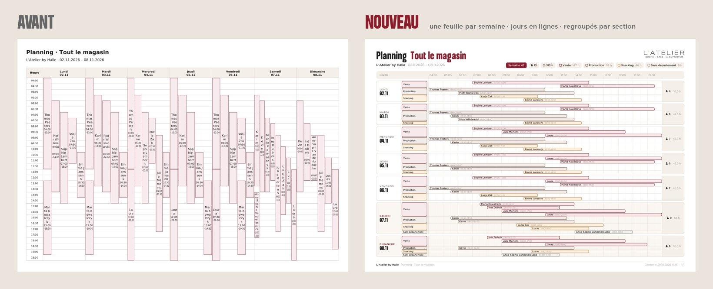

# Planning d'équipe en PDF — aux couleurs de L'Atelier by

**Statut : prêt à intégrer dans l'API, exemples générés.** Demande du 29/10/2026 : reprendre le PDF du
planning (`TeamSchedulePdf` + `TeamSchedulePdfService`, TCPDF, reçus en `.rar`) dans le design system
de la marque, puis : une feuille par semaine, les axes inversés, pas de badges mais des rectangles aux
coins arrondis, un espace entre les jours, et la feuille du magasin regroupée par section. Les plannings de production sont des plannings par
section (`layout=departments`) : dans l'API, un « département » est une section.



## Ce qui change sur la feuille

- **Le design system** (`public/assets/ds/global.css`, `public/employee/assets/atelier/marque.css`) :
  titre en Vank, textes en Gotham Light / Medium, Rubis `#8D1D2C` pour l'accent, beige-doux `#F4EFE8`
  pour les bandeaux, traits chauds `#DED6C9`, logo en haut à droite. Le pied de page est celui des
  rapports PDF du cockpit (`rapPdfPiedHtml()` dans `src/rapports.php`) : magasin, document, date de
  génération, numéro de feuille.
- **Une feuille par semaine** : 14 jours font deux feuilles A4, jamais 14 colonnes serrées. Chaque
  semaine garde sa propre plage horaire (04:00–20:00 au moins) : une nuit en semaine 2 n'étire pas la
  semaine 1. Le rectangle Rubis en tête dit la semaine (« Semaine 45 », « Semaine 45–46 » si la
  période commence en milieu de semaine).
- **Les axes inversés** : les jours en lignes, les heures de gauche à droite. Chaque nom s'écrit à
  l'horizontale, en entier (l'ancienne version coupait « Tho mas Pee ters » en plein mot).
- **Un espace entre les jours** : chaque jour est sa propre carte. Sa hauteur suit le nombre de
  services côte à côte (huit personnes en même temps le samedi = huit lignes), jamais moins de 9 mm.
- **Regroupé par section** (feuille « Tout le magasin », dès qu'il y a plus d'une section) : dans
  chaque jour, Vente, Production, Snacking… dans l'ordre du référentiel, puis « Sans section ». Une
  section sans personne ce jour-là ne prend pas de place. Chaque section a sa couleur, la même
  partout (en tête, dans la colonne des sections, sur les services).
- **Pas de badges** : tout est rectangle aux coins arrondis (rayon ≤ 0,8 mm sur les services, jamais
  une pilule) — l'en-tête (semaine, personnes, heures, heures par section), les sections, les services.
- **Les totaux du jour** dans la colonne de droite : personnes et heures.
- **Les nuits** : un service 22:00–06:00 est coupé à minuit comme avant, mais les deux morceaux
  affichent 22:00–06:00, avec une petite flèche du côté qui continue.

Les plannings par section (`layout=departments`, une feuille par section et par semaine — le planning
de production en est un) suivent la même mise en page, sans la colonne des sections : des services
plus hauts, nom et horaire sur deux lignes, la couleur de la section.

## Fichiers — à copier dans l'API

`livraison/` reproduit l'arborescence de l'API : `TeamSchedulePdf` lit `__DIR__/../../../lang/…`, les
polices et le logo sont lus au même niveau, dans `assets/schedule_pdf/`.

| Fichier | Rôle |
|---|---|
| `livraison/Api/Repositories/Utils/TeamSchedulePdf.php` | Le rendu, réécrit. Même constructeur, même `render()`. |
| `livraison/Api/Services/Employee/TeamSchedulePdfService.php` | Le service, avec quatre ajouts au plan (ci-dessous). `options()`, `generate()`, `lanes()` inchangés. |
| `livraison/assets/schedule_pdf/` | Gotham Light, Gotham Medium, Vank au format TCPDF (`.php` + `.z` + `.ctg.z`), `logo.png`. |
| `livraison/lang/{fr,nl,pl,it,en}/schedule_pdf.json` | Les textes. Si l'API a déjà ses fichiers, n'y ajouter que les trois nouvelles clés. |

**Ajouts au plan** (`TeamSchedulePdfService::plan()`), tous rétrocompatibles :
- `weeks` : les semaines de 7 jours depuis la date de début, chacune avec `dates`, `minimum`, `maximum` ;
- `departments` : `[id => nom]` dans l'ordre du référentiel (couleurs, sections, légende) ;
- sur chaque service : `shift_start` / `shift_end` (les vraies heures), `cut_before` / `cut_after` (nuit coupée à minuit) ;
- sur chaque page de section : `id`.

Le rendu lit tout cela avec des valeurs de repli : un plan de l'ancien service sort encore (une seule
feuille, sans sections). Sans `assets/schedule_pdf/`, la feuille sort en DejaVu, sans logo, complète.

`unassigned` dit désormais « Sans section » (nl Zonder sectie, pl Bez sekcji, it Senza sezione, en No section).

**Nouvelles clés de langue** (facultatives — absentes, l'élément disparaît ou prend `h`) :

| Clé | fr | nl | pl | it | en |
|---|---|---|---|---|---|
| `week` | Semaine | Week | Tydzień | Settimana | Week |
| `hour_unit` | h | u | h | h | h |
| `generated` | Généré le | Gegenereerd op | Wygenerowano | Generato il | Generated on |

## Les polices

- Les Gotham du dépôt sont en CFF (`.otf`) : TCPDF n'embarque que du TrueType. Light, Medium (et
  Vank, déjà en `.ttf`) ont été converties (contours quadratiques, fontTools) puis passées par
  `TCPDF_FONTS::addTTFfont`. Sous-ensemble à l'export : un PDF pèse 80 à 150 ko.
- **Pas de Gotham Regular** : `Gotham_Regular.otf` et `Gotham_Regular_New.otf` n'ont pas les lettres
  polonaises (ź ż ć sortent en blanc). Light et Medium les ont toutes.
- **Vank pour l'ASCII seulement**, comme `unicode-range: U+0020-007E` dans `global.css` : Vank dessine
  ź ż ć en volutes. Un titre accentué passe ces caractères en Gotham Medium (« Cały sklep »).

## Exemples (`exemples/`, aperçus dans `apercus/`)

Deux magasins fictifs : Halle (13 personnes, 3 sections, une étudiante sans section, huit services en même
temps le samedi, deux nuits au labo la deuxième semaine) et Knokke (4 personnes, pas de sections).

| Fichier | Mise en page | Jours | Langue | Feuilles |
|---|---|---|---|---|
| `planning-magasin-7j-fr.pdf` | Tout le magasin, par section | 7 | fr | 1 |
| `planning-sections-7j-fr.pdf` | Par section (dont la production) | 7 | fr | 4 |
| `planning-magasin-14j-nl.pdf` | Tout le magasin — semaine 2 sur 24 h (nuits) | 14 | nl | 2 |
| `planning-magasin-7j-pl.pdf` | Tout le magasin — lettres polonaises, nuits | 7 | pl | 1 |
| `planning-sections-14j-en.pdf` | Par section | 14 | en | 8 |
| `planning-petit-magasin-7j-it.pdf` | Petit magasin sans sections : tout en Rubis | 7 | it | 1 |
| `avant-magasin-7j-fr.pdf` | La version reçue le 29/10, mêmes données | 7 | fr | 1 |

## Régénérer

```
composer require tecnickcom/tcpdf     # dans un dossier à part, TCPDF 6.x
php docs/maquettes/planning-pdf/generer.php <ce dossier>/vendor/autoload.php
```

## Limites

- Un jour très chargé sur la feuille du magasin (dix services côte à côte, quatre sections) donne
  des lignes d'environ 2,5 mm : le nom reste lisible, en 5,5 à 6 points.
- Un service d'une demi-heure fait 6 à 7 mm de large : le nom s'y abrège (« Z… »), l'horaire se lit
  sur la grille.
- Au-delà de sept sections, les couleurs reprennent depuis le début de la palette ; les rectangles
  de section en tête s'arrêtent avant de toucher le sous-titre.
