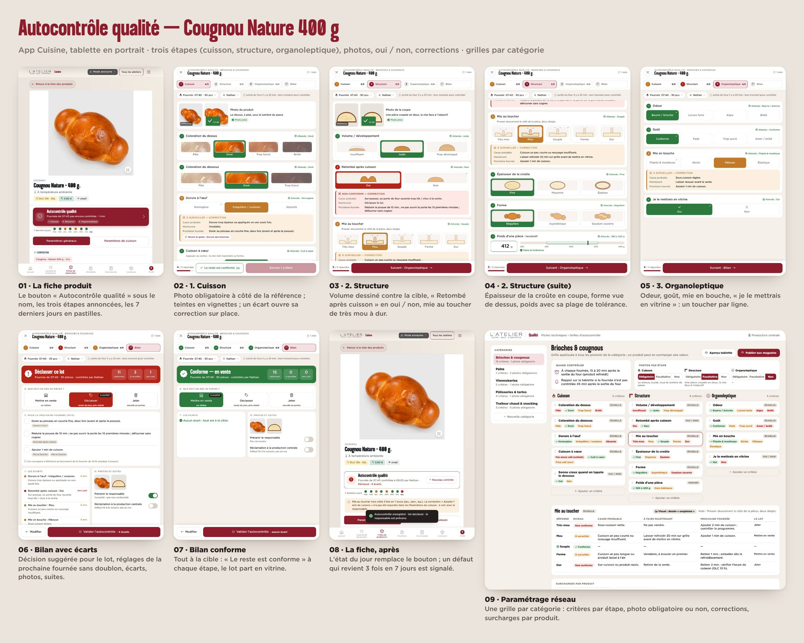

# Autocontrôle qualité par produit — app Cuisine, tablette (maquettes du 24/11/2026)

Sam, sur la fiche produit de l'app Cuisine en tablette (capture du Cougnou Nature 400 g) : « rajouter un bouton
autocontrôle qualité, avec 1. cuisson, 2. structure, 3. organoleptique, avec des photos (oui / non), des corrections ;
un système d'autocontrôle par produit, avec des boutons à variables (mou, très mou, dur, grosseur de la croûte,
retombé après cuisson) ; ça doit être rapide, intuitif et complet ».

La fiche est la **vraie page** de l'app Cuisine (dépôt `ThaiZu/TFB-Kitchen`, `knowledge/product/detail.twig`), relevée
sur une instance locale avec un bouchon qui sert les valeurs de la capture (`contexte/`). L'autocontrôle y est greffé
par `autocontrole.js`, qui se clique de bout en bout.



## Les écrans

| # | Écran | Ce qu'il montre |
|---|---|---|
| 01 | `01-fiche-bouton.jpg` | Le bouton « Autocontrôle qualité » sous le nom du produit, au-dessus des onglets : la fournée à contrôler, les trois étapes, les 7 derniers jours en pastilles. |
| 02 | `02-cuisson.jpg` | Étape 1. Photo obligatoire à côté de la référence ; coloration du dessus et du dessous en vignettes (pâle → brûlé) ; dorure ; cuisson à cœur ; « sonne creux » en oui / non. Un écart ouvre sa correction sur place. |
| 03 | `03-structure.jpg` | Étape 2. Volume dessiné contre la cible (pointillés), « Retombé après cuisson » en oui / non, mie au toucher sur cinq crans (très mou, mou, souple, ferme, dur). |
| 04 | `04-structure-suite.jpg` | Épaisseur de la croûte (fine, moyenne, épaisse) en coupe, forme vue de dessus, poids d'une pièce avec sa plage (facultatif). |
| 05 | `05-organoleptique.jpg` | Étape 3. Odeur, goût, mie en bouche, « je le mettrais en vitrine ». |
| 06 | `06-bilan.jpg` | Le bilan : décision suggérée pour le lot (vente, déclasser, jeter), réglages pour la prochaine fournée sans doublon (« +1 min de cuisson » vient de deux critères), écarts, photos, prévenir le responsable, réclamation à la production centrale. |
| 07 | `07-bilan-conforme.jpg` | Le chemin rapide : tout à la cible, le lot part en vitrine. |
| 08 | `08-fiche-apres.jpg` | Sur la fiche, l'état du jour remplace le bouton ; un défaut qui revient 3 fois en 7 jours est signalé, avec sa correction non reportée dans les Paramètres de cuisson. |
| 09 | `09-parametrage.jpg` | Côté réseau : une grille par catégorie, critères par étape, photo obligatoire / facultative / non par étape, corrections par réponse, surcharges par produit. |

## Rapide, intuitif, complet

- **Rapide** : une réponse = un toucher ; une réponse conforme fait défiler au critère suivant ; « Le reste est
  conforme » remplit d'un coup ce qui reste à la cible ; la fournée (module Cuisson) et la personne en poste sont
  préremplies. Un produit conforme se contrôle en trois écrans et un bilan.
- **Intuitif** : la cible est marquée sur chaque critère (✓ et « Attendu : … ») ; les réponses sont des images
  (teintes de la photo du produit, dessins du volume, de la croûte, de la souplesse, de la forme) ; vert = conforme,
  orange = à surveiller, rouge = non conforme.
- **Complet** : photos par étape, oui / non, mesures, échelles ; chaque réponse hors cible porte sa **cause probable**,
  ce qu'on fait **maintenant** du lot et ce qu'on change à la **prochaine fournée** ; le bilan en déduit la décision,
  les suites (responsable, réclamation, pertes) et l'historique repère les défauts récurrents.

## La grille (`grilles.json`)

Une grille par **catégorie** (Brioches & cougnous, Pains, Viennoiseries, Pâtisseries & tartes, Traiteur chaud &
snacking), surchargée au besoin par **produit** (`produits.1700400.surcharges.poids` : 400 g, 380 à 420 g).

- `photos` : par étape, `obligatoire`, `facultative` ou `non` (les « photos oui / non » de la demande) ;
- `criteres[]` : `etape` (`cuisson`, `structure`, `organoleptique`), `type` (`echelle`, `oui_non`, `mesure`),
  `visuel` (`teinte`, `volume`, `retombe`, `croute`, `souplesse`, `forme`) ;
- chaque réponse : `niveau` (`ok`, `mineur`, `majeur`), `cible`, et hors cible `cause`, `maintenant`, `prochaine`,
  `decision` (`vente`, `declasser`, `jeter`), `sop` (le geste à revoir), `reclamation` (défaut du produit cru).

Les critères, niveaux et corrections sont **des exemples à valider par la production** ; aucune valeur de four
(température, programme) n'est écrite : les corrections restent relatives (« +1 min », « −10 °C »).

## Ce qu'il faudra pour le faire vraiment (à décider)

- **App Cuisine** (`ThaiZu/TFB-Kitchen`) : le bouton dans `knowledge/product/detail.twig`, l'écran plein écran, la
  photo par `<input type="file" accept="image/*" capture="environment">`. Elle ne parle qu'à l'API de l'ERP
  (`KITCHEN_API_BASE`).
- **API** (proposition) : `GET /products/{id}/quality-grid` (grille de la catégorie + surcharges du produit),
  `POST /shops/{id}/quality-checks` (fournée, personne, réponses, photos, décision, suites),
  `GET /shops/{id}/quality-checks?product=&days=7` (historique et défauts récurrents). La décision « jeter » passe par
  l'encodage des pertes existant (`/shops/{id}/waste-reports`) ; la réclamation par le module Réclamations de l'app
  (`Complaint`).
- **Où vivent les grilles** : avec la fiche technique et les paramètres de cuisson (ERP), ou dans le domaine Formation
  du cockpit, à côté du manuel « Fiches techniques ». Le cockpit (consultant, dashboard du franchisé) lirait les
  résultats par l'API, jamais dans les tables.
- **Photos de référence** : les vignettes de teinte sont la photo du produit filtrée, les autres visuels des dessins ;
  à remplacer par de vraies photos de défauts, prises une fois par la production centrale.

## Régénérer

```bash
node formation/docs/maquettes/autocontrole-qualite/generer.js
```

Le script sert lui-même la racine du dépôt (port 8099) et refait les neuf captures (820 × 1180 en tablette, 1440 ×
1240 au bureau) et la planche. Pour voir les écrans à la main, servir la racine du dépôt et ouvrir
`formation/docs/maquettes/autocontrole-qualite/fiche.html` (tout se clique) ou `fiche.html#ecran=bilan&demo=ecarts`
(`ecran` : fiche, cuisson, structure, organoleptique, bilan, fait ; `demo` : ecarts, conforme ; `defiler` : un critère).

Pour relever à nouveau la fiche réelle quand l'app change : `figer.js` (mode d'emploi en tête du fichier, avec le
bouchon `contexte/bouchon.php`). Les polices sont celles du design system (`shared/public/assets/ds/fonts/`) : le
trait Gotham Book de l'app, absent du dépôt, y est rendu par Gotham Medium.
